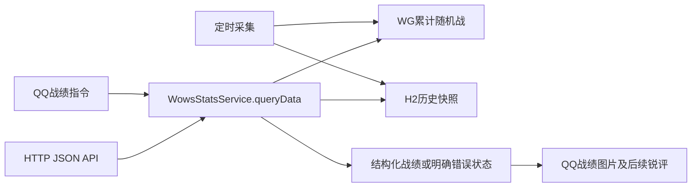

# 自建战舰世界战绩 API：源码分析与使用

> 当前状态（2026-10-24）：按用户要求停用战绩业务，不再继续优化。配置 `wows-stats.enabled: false`，HTTP查询返回503、聊天返回关闭提示，后台不采集、启动不打开战绩数据库，旧数据保留。以下内容为历史实现说明，更新JAR重启后停用生效。

日期：2026-10-24。实现位于现有 Java 17 服务中，不额外部署 Python、MySQL、Redis，也不需要 Yuyuko Token。获取上游累计战绩仍需自己的 `WOWS_STATS_APPLICATION_ID`。

## 源码分析得到的事实

| 仓库/文件 | 可以确认的实现 | 不能据此声称的能力 |
| --- | --- | --- |
| [Hikari-core](https://github.com/wows-yuyuko/Hikari-core)，`moudle/wws_info.py`、`moudle/wws_recent.py`、`HttpClient_Pool.py` | 机器人客户端调用 Yuyuko 总体/近期接口，携带鉴权和客户端信息，近期结果按PVP/排位分类 | 这些文件不是Yuyuko服务端，不能由客户端还原其完整采集、存储和限流实现 |
| [WowsApi](https://github.com/wows-yuyuko/WowsApi) | 对public/Vortex数据的Java SDK，README链接到派生平台 | SDK不是其平台的完整服务端源码；新版JDK21也不能直接加入本项目 |
| [Kokomi update.py](https://github.com/Hanserprpr/KokomiPJ_MainAPI/blob/main/tool/recent/update.py) | master/slave采集分工；按账号、区服建立本地数据库；按区服时区分日期；写入累计场次及舰船数据；跨日处理和历史清理；依据活跃程度/当地时段调整采集间隔；新用户初始化基线 | 初始化昨天和今天的记录使用同一份当前累计值，不等于回填真实昨天战绩 |
| [Kokomi network.py](https://github.com/Hanserprpr/KokomiPJ_MainAPI/blob/main/tool/recent/network.py) | Vortex主机映射；累计指标索引含场次、胜场、伤害、击沉、存活、经验；调用自身平台维护跟踪用户 | 本次读取版本的`Update`引用了该`Network`类未定义的`get_basic_data`/`get_recent_data`，说明这份公开快照并非完整可直接运行的闭环 |
| [Kokomi recent_data.py](https://github.com/Hanserprpr/KokomiPJ_MainAPI/blob/main/app/apis/recent/recent_data.py) | 有近期用户概况查询；按日期方法为占位 | 不能声称已通过该版本验证任意日期的线上差值结果 |

原理上可以自己构建同类服务：定时采集累计战绩，保留历史基线，在查询时计算差值。Kokomi采集代码支持这一架构判断；其完整查询算法在本次取得的源码中未完成确认。我们独立实现所需功能，不复制其代码或假设未公开部分。

本次静态读取的采集文件SHA256（对应2026-10-24下载内容，分支链接以后可能变化）：

- `update.py`：`C4CDF0244EAE59EFC4C8A8CCEA026528D3E939CF7A4971F0A99AAA77B5081D92`
- `network.py`：`A32C02EFAFBB9097B298132792A76904C0BED24A0D9DE81FA77A905FE94A2C89`

整仓ZIP下载不完整，未用于分析；上述结论来自逐文件读取。没有安装或执行第三方代码。Vortex只是潜在累计数据适配器，本次没有将未经真实玩家验证的Vortex响应接入默认源。

## 本项目实现



HTTP和聊天直接调用同一服务，无本机HTTP绕行、无重复查询、无报告文本反向解析。`queryResult()`根据结构化数据生成原有报告；图片与锐评分开发送的行为保持。JSON接口只返回数据，不生成图片或锐评。

累计随机战包含单野和组队。近期使用累计**总数**相减：区间场次=当前场次−起点场次，区间胜场/总伤害等同理；胜率=区间胜场÷区间场次×100，场均伤害=区间总伤害÷区间场次。不能拿两个累计胜率或场均伤害直接相减。

## 调用接口

随机器人JAR启动，使用当前服务端口。接口复用现有管理访问边界：未设`BOT_ADMIN_TOKEN`仅允许本机；设置后必须携带`Authorization: Bearer <自己的管理Token>`。POST还需`X-Requested-With: AlmondAdmin`，`Content-Type: application/json`。不要将Token写进URL。

| 方法/路径 | JSON请求 |
| --- | --- |
| `POST /admin/api/wows/overall` | `{"region":"ASIA","player":"Test_Player"}` |
| `POST /admin/api/wows/recent` | `{"region":"ASIA","player":"Test_Player","days":7}` |

`region`支持ASIA/EU/NA和既有中文别名；`player`为完整昵称或数字账号ID。`overall`不接受days；`recent`必须指定1–365的整数days。身份字段不得包含空格或拼接命令。

PowerShell示例（`Test_Player`为占位昵称，请替换）：

```powershell
$headers = @{'X-Requested-With'='AlmondAdmin'}
if ($env:BOT_ADMIN_TOKEN) { $headers['Authorization'] = 'Bearer ' + $env:BOT_ADMIN_TOKEN }
$body = @{region='ASIA'; player='Test_Player'; days=7} | ConvertTo-Json
Invoke-RestMethod -Method Post -Uri 'http://localhost:8080/admin/api/wows/recent' `
    -Headers $headers -ContentType 'application/json; charset=utf-8' -Body ([Text.Encoding]::UTF8.GetBytes($body))
```

接口不是Yuyuko协议兼容实现，不能不修改调用方就替换其URL。远程客户端也需按以上访问边界调用。

## 响应合同

业务响应字段如下；畸形JSON、缺失请求体及认证失败由现有HTTP框架/过滤器返回错误，不保证包含完整Stats字段。

| 字段 | 含义 |
| --- | --- |
| `status`, `message` | 稳定状态枚举和可读提示；成功为`OK` |
| `source` | 当前固定`WG_PUBLIC_API_LOCAL_SNAPSHOTS`，明确实际上游和本地历史来源 |
| `battleType` | 固定`PVP`，随机战含单野与组队 |
| `requestedDays` | 总体为0，近期为指定天数；未进入查询的失败响应为0 |
| `player` | 已获取的当前累计玩家资料；`random`仍是累计随机战，**近期指标应读顶层totals**；失败可能为null |
| `totals` | 本次范围内的场次battles、胜场wins、总伤害damage、击沉frags、存活survived、总经验xp；失败为null |
| `metrics` | 本次范围的winRate、averageDamage、averageFrags、survivalRate、killDeathRatio、averageXp；百分比使用0–100；零场次全部null，无阵亡K/D为null |
| `requestedFrom` | 近期请求目标起点；总体或未到该阶段为0 |
| `observedFrom`, `observedTo` | 实际快照采集起止时间；总体起点为0；起点缺失时为0 |

三个窗口时间均为Unix毫秒；`player.updatedAt`保留上游Unix秒单位。`observedTo`可能来自60秒缓存，并非本次HTTP请求的时间。上游更新可能延迟，实际采集时间不等于逐局发生时间。经验沿用上游值，可能含高级账号加成。

| HTTP | status | 调用方处理 |
| --- | --- | --- |
| 200 | OK | 使用顶层totals/metrics |
| 400 | INVALID_REQUEST | 修正参数 |
| 409 | HISTORY_UNAVAILABLE | 已取得当前数据并开始跟踪，等历史积累；不得当作零场次 |
| 409 | COUNTER_RESET | 累计统计回退或口径变化，本次不出近期数据 |
| 429 | RATE_LIMITED | 稍后重试 |
| 503 | DISABLED / NOT_CONFIGURED | 启用功能或配置WG应用标识 |
| 502 | UPSTREAM_ERROR | 上游/保存失败；账号不存在、隐藏等受控错误也归入此状态，读取message |

## 历史与运行限制

复用现有H2独立战绩库：每区服/账号/UTC小时一份最新快照，保留400天；最多跟踪100个账号，淘汰会连带删除其快照。查询成功即采集并跟踪，不依赖必须在QQ内查询。每5分钟运行一次任务，每轮最多20个、每账号至少间隔1小时，仅刷新最近30天有人查询的账号；失败不会伪造快照。关闭功能停止查询与采集。

首次查询7天近期通常返回历史不足，持续运行满7天且存在请求起点前2小时内的快照后才能计算。窗口是滚动N×24小时，不是Kokomi按区服日历的“自然日”；返回实际起止时间。服务离线、接口故障或账号被淘汰都会造成缺口。不会从当前累计值推算过去每日数据，不自动调用第三方历史接口。

查询缓存60秒、全局未缓存请求至少间隔3秒（聊天/API共享）。采集、缓存和数据库目前适合单实例小规模机器人，不是全服爬取平台；多实例不能共享打开同一H2文件。完整备份须停服复制整个data目录，管理配置SQL不包含战绩库。此版本不改表结构，已有快照直接复用。

## 验证范围

新增HTTP路由、JSON序列化、管理鉴权与POST来源头、三服、近期差值、实际时间范围、缓存复用、历史不足、参数注入/越界、配置/限流状态和空指标测试。真实WG账号端到端查询仍需运行环境配置有效application_id；不将模拟测试当作线上数据验收。最终构建结果见主报告本次修改日志。

最终构建于2026-10-24 00:47:26完成：适用回归250项通过（沿用排除AdminApiTests/OneBotWebSocketTests），JAR为`target/Almond_Eye_Bot-0.0.1-SNAPSHOT.jar`。战绩专项43项通过，其中新增接口测试9项。日志分别为`target/wows-self-hosted-package-final.log`及`target/wows-api-tests-authorized.log`。
