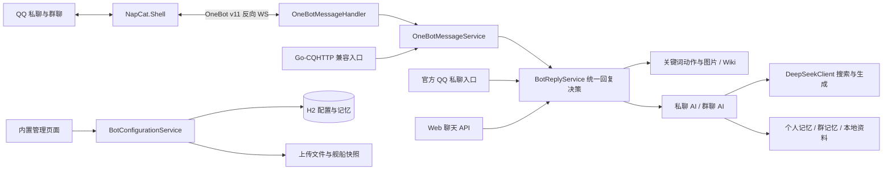

# Almond_Eye_Bot 代码结构与功能分析报告

当前维护方向（2026-10-24）：**战绩查询已在配置中停用，不再继续优化此业务**。聊天和HTTP入口受关闭开关保护，后台不采集，启动不打开战绩数据库；保留源码及既有快照。更新JAR重启后生效，停用记录见 CHANGE-20261024-003。船只资料库、普通聊天、人设、记忆和搜图等其他业务保持。

新增群语言学习（2026-10-24）：`GroupLearningService`从已启用群的新成员消息采集有限内存样本，低频提取表达短语与黑话，独立持久化并按群加入回复参考；不写核心人设、不训练模型权重。单批40–60条且至少3位成员，单群6小时间隔、全局30分钟间隔及每天4批上限，独立后台线程执行。管理接口提供查看/清除，配置、行为与限制详见README“群表达与黑话学习”；修改明细见 CHANGE-20261024-004。

人格学习管理页（2026-10-24后续）：左侧新增“人格学习”，支持群搜索/选择、表达与黑话分栏、逐条删除、清空当前群内容和即时全局/单群开关。开关持久化并随SQL备份，纠错校验修订号，关闭/删除/清空使在途旧批次失效，普通聊天与核心人设不变。详见 CHANGE-20261024-005。

群人设隔离（2026-10-24后续）：核心人设按机器人QQ＋群号独立保存在 `group_persona`，私聊/Web默认人设继续单独保存。管理页“人设配置”先选择范围再编辑；群内个人记忆同步按机器人QQ＋群号＋用户QQ隔离，不再从其他群或私聊注入个人对话。已有群在升级时获得原共用人设的独立副本，新群使用内置默认；详见 CHANGE-20261024-006。

分析日期：2026-10-23  
分析对象：当前工作区 `Almond_Eye_Bot` 源码、配置、SQL、前端和测试代码。  
初始分析方法：静态阅读与调用关系核对；初次分析未启动机器人、运行测试、登录 QQ 或调用外部服务。后续优化的验证结果见第 13 节修改日志。本文描述代码所表达的行为，不代表实际部署已通过验收。未展开分析 `NapCat.Shell` 内部实现，也未读取运行数据库中的聊天内容。

2026-10-24新增自建战绩JSON接口：`POST /admin/api/wows/overall`、`POST /admin/api/wows/recent`，复用管理鉴权及同一份聊天战绩服务；上游仍为WG累计数据，近期由自建历史快照计算。第三方采集源码分析、完整请求/响应合同和历史限制见 [自建战绩API说明](docs/wows-self-hosted-api.md)，本次修改明细见 CHANGE-20261024-002。

## 1. 项目定位与整体架构

这是一个 Java 17、Spring Boot 4.0.5 的单体 QQ 聊天机器人服务。NapCat 负责维持 QQ 登录并提供 OneBot 接口；Almond_Eye_Bot 负责消息解析、群权限、关键词规则、AI 对话、记忆、检索和管理页面。

项目当前以 **OneBot v11 反向 WebSocket** 为主要接入方式：NapCat 主动连接后端 `/onebot/ws`，事件和发送消息的 action 共用这一条双向连接。后端不负责登录 QQ，不主动重连 NapCat。



主要技术依赖由 [pom.xml](pom.xml) 定义：Spring MVC、WebSocket、RestClient、H2、Fastjson2、Jsoup、Lombok、Commons Codec、EdDSA。业务 HTTP 调用主要使用 `RestTemplate`，持久化使用原生 JDBC，没有 JPA/MyBatis，也没有外部 Redis、消息队列或向量数据库。

## 2. 目录结构

```text
Almond_Eye_Bot/
├─ pom.xml、mvnw、mvnw.cmd         Maven 构建与启动
├─ README.md                      使用、接入和配置说明
├─ src/main/java/org/almond_eye_bot/
│  ├─ AlmondEyeBotApplication.java Spring Boot 主入口
│  ├─ config/                     配置模型、WS 注册和访问控制
│  ├─ controller/                 管理、Web、官方 QQ、Go-CQHTTP 入口
│  ├─ handler/                    OneBot WebSocket 事件处理
│  ├─ client/                     OneBot、AI、QQ、Go-CQHTTP 客户端
│  ├─ service/                    回复编排、记忆、检索、图片等业务
│  └─ util/                       签名、HMAC 和异常处理工具
├─ src/main/resources/
│  ├─ application.yml             环境变量、连接和业务配置
│  ├─ application.properties      应用名称
│  ├─ db/                         建表与默认规则迁移 SQL
│  ├─ static/admin/               原生 HTML/CSS/JS 管理界面
│  └─ assets/chatPic/             随 JAR 打包的内置图片
├─ src/test/                      Java 测试及测试专用配置
├─ scripts/
│  ├─ sync_wows.py                战舰世界全量数据同步
│  └─ test_sync_wows.py           同步脚本测试
├─ webchat/index.html             独立 Web 聊天页面
├─ data/                          运行期 H2 与舰船数据
├─ uploads/                       上传图片和资料原文件
└─ target/                        构建产物
```

`data/`、`uploads/` 是外置运行数据，路径取决于启动工作目录或 `BOT_STORAGE_DIRECTORY`，不能仅备份 JAR。`webchat/` 与 `static/admin/` 的部署方式不同：管理页会随 Spring Boot 打包，独立聊天页不在标准静态资源目录中。

## 3. 主要模块及职责

| 模块 / 核心类 | 实际职责 |
| --- | --- |
| `WebSocketConfig`、`OneBotProperties` | 根据配置启用 WS 路由，保存 token、路径、超时等参数 |
| `OneBotHandshakeInterceptor` | 校验握手的 `Authorization: Bearer …` |
| `OneBotMessageHandler` | 区分事件与 action 回执、事件去重、线程池投递、连接时发现账号与群列表 |
| `OneBotClient` | 生成 echo、发送 action、通过 CompletableFuture 关联回执、处理超时和断线 |
| `OneBotMessageService` | 解析数组消息/CQ 码、识别 @、过滤自身消息、记录群记忆、封装分段回复 |
| `BotReplyService` | 跨传输统一回复决策，执行数据库规则定义的动作 |
| `AiChatService` | 私聊和 Web 等非群场景的模型调用、个人记忆与资料注入 |
| `GroupAutoReplyService` | 群 AI 的准入、额度、冷却、单群忙碌状态及群上下文拼装 |
| `ConversationMemoryService` | 个人对话归属、近期上下文、50条触发后台滚动摘要，保留在途新增记录 |
| `GroupMemoryService` | 群消息记录、100条触发后台群摘要，继续追加与限制上下文预算 |
| `MemorySummaryQueue`、`MemorySummaryBatch` | 回复提交后的后台任务、去重/退避/取消、完整记录前缀批次选择 |
| `KnowledgeBaseService` | 资料库路由、文本片段评分、注入检索结果；无向量模型 |
| `LocalShipDataService` | 仅读取本地战舰快照，舰名匹配、消歧、相关字段选择 |
| `DeepSeekClient` | 搜索与生成请求、思考模式、输出预算、外部响应解析 |
| `BotConfigurationService` | H2 初始化/迁移、配置与规则 CRUD、文件验证、记忆持久化、SQL 导出 |
| `LocalImageService`、`WikiService` | 内置/随机图片，FF14 Wiki 检索与网页内容提取 |
| `AdminController`、`AdminAccessFilter` | 管理 API、访问控制及上传下载 |
| `QQMessageService`、`QQApiClient` | 保留的官方 QQ 传输适配 |
| `GoCQMessageService`、`GoCQHttpClient` | 兼容 HTTP 传输，消息处理转交 OneBot 业务层 |
| `ReplyTextSplitter` | 按句拆分、长句分段及链接/代码保护 |
| `WowsStatsClient`、`WowsStatsData` | 官方三服账号检索、战绩字段核验、区服/命令/累计统计模型 |
| `WowsStatsService` | 总体/近期报告、本地锐评、60 秒缓存与用户请求限流、定时公开数据采集 |
| `WowsStatsRepository` | 独立 H2 玩家快照与跟踪列表、小时合并、历史基线、容量/时间清理 |
| `WowsReportRenderer` | 本地 Java2D PNG 战绩卡，中文字体检测、指标布局、长行换行；失败回退完整文本 |

项目已有明显分层，但配置和持久化集中在约 789 行的 `BotConfigurationService`；资料检索服务及部分记忆服务由业务代码直接 `new`，并非全部依赖注入。

## 4. 启动与消息处理链路

### 4.1 启动过程

1. `AlmondEyeBotApplication.main()` 启动 Spring Boot，加载 YAML 与环境变量。
2. `BotConfigurationService` 创建存储目录、建立 H2 文件连接，执行 `bot-schema.sql`。
3. 初始化功能开关、人设和舰船检索设置；按 `bot_migration` 记录执行一次性迁移。
4. 默认规则写入后，`core_auto_chat_v1` 迁移停用 AI 指令、Wiki、帮助和清除历史动作，并关闭 Wiki 总开关；保留普通聊天作为主要使用方式。
5. OneBot 启用时注册 WS 入口；NapCat 连入后请求 `get_login_info` 和 `get_group_list`。发现的群默认关闭，不自动授权。

### 4.2 一条 OneBot 消息的处理顺序

1. Handler 只投递 `post_type=message` 的事件；action 回执另交 `OneBotClient`。
2. 用机器人、消息类型、群、用户、消息 ID 组合去重。WS 缓存最多 10000 项，有效窗口约 10 分钟，仅在进程内有效。
3. 使用 4 个工作线程、容量 128 的队列处理业务；满队列时丢弃本次事件并记录日志。
4. `OneBotMessageService` 接受私聊/群聊，过滤机器人自身消息；未开启的群立即返回。
5. 已开启群先记录成员消息；图片、语音等仅记录类型占位。此步骤在回复率、关键词及群 AI 限制之前。
6. 提取纯文本、是否 @机器人、是否 @其他人。没有文本则不生成回复，但群内非文本消息可能已被记录。
7. `BotReplyService` 对非 @机器人的群消息抽取一次回复概率；未抽中则结束。私信和 @机器人跳过概率判断。
8. 计算数据库规则匹配及资料命中。**普通回复选择优先级为：自建资料库 → 舰船本地检索 → 普通规则 → 普通 AI**；后续新增的明确 `TAG_IMAGE` / `WOWS_STATS` 动作若被规则系统选中，会直接执行，不让资料命中覆盖其意图。实现上会先计算 `configuration.match()`，再判断资料命中，因此这里的优先级指最终执行路径。
9. 命中资料时进入 AI 路径，即使已有普通关键词规则也不会执行该规则；若此时 AI 关闭，则没有回复，不回退到固定关键词。
10. 回复通过发送锁保持同一目的地的分段写出顺序；每段发送前重查群开关。仅明确 @机器人的消息在首段/首图附带引用。

群开关覆盖全部功能；群 AI 的冷却和每日额度不限制本地固定回复，但回复率会影响普通群关键词回复。

## 5. 机器人功能清单

### 5.1 自动聊天与按群独立人设

私信及已开启群的普通文本无需前缀即可调用 AI。群聊还拒绝 @其他人的消息、纯链接和超过群输入上限的文本；@机器人不绕过群开关或 AI 额度。

私聊/Web默认人设保存在 `bot_persona`；群人设保存在 `group_persona`，按机器人QQ＋群号分配，包含prompt和revision。管理页“人设配置”选择范围后保存，下一次请求读取最新内容，最长8000字符；群留空使用内置默认，不动态继承私聊或别群。升级一次性将原共用人设复制为已有群的独立副本，新群默认空配置。普通聊天禁用思考模式；内部推理能力也按实际会话范围读取人设，当前Controller没有单独暴露推理接口。

`PersonaContext`继续将历史机器人回答及个人摘要作为明确标记的参考数据，不再作为assistant风格示例；当前范围的人设优先。群AI在模型返回后比较当前群人设及修订号，生成期间更改后丢弃旧结果，即使文本改回也能识别旧任务；修改其他群或私聊不抑制本群回答。私聊仍比较默认人设。额度与冷却不退回，不撤回已提交消息，也不强行取消模型请求。

AI 失败、超时、空内容等通常静默处理，不发送等待提示，不把失败回答加入个人记忆。私聊输入和回复截取到 4000 个 Java 字符；不能把所有字符限制都理解为 Unicode 码点限制。

### 5.2 关键词与图片

规则来自 H2 的 `reply_rule`，按优先级降序、ID 升序选择首条命中；支持 `EXACT` / `CONTAINS`，优先级 0–999。

| 动作类型 | 功能 |
| --- | --- |
| `REPLY` | 固定文字、上传图片或两者组合；`ping → pong` 属于这种规则 |
| `AI` | 提取关键词后的参数进行 AI 对话 |
| `WIKI` | 按参数检索 FF14 Wiki |
| `CLEAR_HISTORY` | 清除当前用户个人记忆及摘要 |
| `HELP` | 从启用且功能开关允许的规则动态生成帮助 |
| `DAHUI_IMAGE` | 随机选择内置“打灰”图片 |
| `SIZHAI_IMAGE` | 内置“香草马娘”图片 |
| `RANDOM_IMAGE` | 使用外部图片服务获取随机马娘图片 |
| `TAG_IMAGE` | 按 1–2 个站点 tag 检索 General 分级图片，发送一张图片及原帖链接；不调用 AI |
| `WOWS_STATS` | 官方亚欧美服玩家总体/近期随机战报告及本地辛辣点评；近期依赖已有快照 |

固定回复区分大小写，功能动作的英文匹配不区分大小写；英文边界避免 `AI` 命中 `OpenAI`。AI/Wiki 的参数与关键词通过空格分隔。删除或停用规则后，没有硬编码的同名命令兜底，但文本仍可能进入普通 AI。

上传图片支持 PNG、JPEG、GIF，单张最大 10MB、2000 万像素，并验证实际图片内容。被规则引用的资源不能直接删除。OneBot 图片采用 Base64 消息段，无需与 NapCat 共享磁盘。

2026-10-23 新增 `TagImageService`，使用配置的 Danbooru 兼容 `/posts.json` 接口。默认触发 `搜图 hatsune_miku`，可在规则页改名/停用/删除；`tag_image_v1` 迁移仅初始化一次，SQL 导出改为保存实际迁移标记。明确命中的 `TAG_IMAGE` 动作优先于资料路由，仍受普通规则排序、群开关和群回复率控制，独立于 AI 额度及原有功能开关；另有 `IMAGE_SEARCH_ENABLED` 环境开关和共享冷却。

服务固定附加 `rating:g order:random` 并核验响应分级、帖子状态，拒绝用户 metatag/OR 等表达式；仅发送 1–2 个显式 tag，不传人设或聊天历史。图片通过精确允许主机、HTTPS、禁重定向及有界流读取后，校验格式、像素和可解码性，再使用既有 Base64 图片链路。每张最多 8MB；图片站配置及详细使用方式见 README“Tag 关键词搜图”。不自动翻译 tag，不通用支持所有 booru API，站点分级不等于独立图像审核。

随机搜图现增加持久化去重：机器人同群共享目标记录，私聊及 Web 分开；目标使用哈希保存，图片使用站点与 MD5（无有效 MD5 时使用帖子 ID）生成标识，不依赖 tag。跳过近期标识后继续按随机候选顺序选择，遇重复最多获取 3 批、每批 20 个候选，总下载尝试仍最多 3 次。记录保留最近 200 张/7 天，全局上限 10000 条，下载校验成功后写入；不是最终送达确认，不做视觉相似度分析。新表 `tag_image_history` 自动创建，运行期重启保留，配置 SQL 不导出其内容并在恢复时清空。详细边界见修改日志 `CHANGE-20261023-004`。

### 5.3 群聊策略与用量

| 项目 | 新群默认值 / 行为 |
| --- | --- |
| 群总开关 | 关闭，需管理员明确开启 |
| 自动回复率 | 1，可设为 0–1；普通关键词同样受控 |
| AI 冷却 | 30 秒 |
| 每日 AI 次数 | 50 次，按北京时间计日 |
| AI 输入上限 | 500 字符 |
| AI 输出预算 | 256 Token |
| 个人近期上下文 | 3 轮；摘要另外携带 |
| 群近期上下文 | 最近 2N 条，最多 100 条；N 为个人近期轮数 |

用量在联网前预留，失败尝试也计次，重启不重置。个人摘要、群摘要额外占用群每日调用次数，摘要不占普通回复冷却。搜索虽产生额外 HTTP 请求，但不是独立的群额度预留项。

同群AI执行时跳过新群AI请求；个人记忆锁及数据键按所在范围隔离，同一QQ在不同群或私聊不共用记忆。锁使用固定条带数组，偶发哈希碰撞可能串行执行，但不会合并数据。

### 5.4 个人记忆与群记忆

| 维度 | 个人记忆 | 群记忆 |
| --- | --- | --- |
| 隔离键 | 私聊`qq:机器人QQ:用户QQ`；群内个人`group-user:机器人QQ:群号:用户QQ` | `group:机器人QQ:群号` |
| 整理阈值 | 50条；一条为一轮成功问答或摘要，允许暂时积压 | 100条；成员发言、机器人分段分别计条，允许暂时积压 |
| 内容 | 用户输入、AI 回答、长期摘要 | QQ、名称、时间、文本、机器人标记、摘要 |
| 触发记录 | 成功生成 AI 回答 | 已开启群成员消息及机器人提交发送的消息 |
| 压缩 | 达阈值后，回复提交完成再后台摘要，只替换已归纳的旧前缀 | 本次消息/回复提交结束后后台摘要，只替换已归纳的旧前缀 |
| 失败处理 | 原记录与新增问答继续落库，不阻止回答；后续活动退避重试 | 原记录与新增消息继续落库，不停写；后续活动退避重试 |

群摘要失败重试至少间隔 60 秒。群上下文正文预算为 12000 字符，每条再受群输入长度限制；N=0 时仍可携带摘要。Web 与官方 QQ 会话使用独立的哈希会话命名空间，不与数字 QQ 记忆混合。清除历史不清除全群公共记忆。

当前后台整理使用每个配置库实例独立的2线程/128排队容量池，同一记忆目标不重复执行；OneBot、HTTP兼容、官方QQ及Web在本次回复构建/提交阶段结束后投递。直接调用AI服务时同样异步但没有传输阶段。模型请求期间不持有记忆锁；成功结果在短锁和数据库事务内校验旧前缀仍一致，再用“摘要＋未归纳后缀”替换，避免覆盖在途新消息。清除个人历史会取消任务令牌，群关闭/AI关闭也会抑制结果提交。

摘要请求输出预算为2048 Token，提示控制在1200中文字符，仍只接受正常完整结束、非空且不超过4000字符的摘要；非正常 finish_reason 写入警告日志而非双重错误堆栈。长历史按完整记录选择较小旧前缀，避免整库一次发送。50/100为软阈值，旧库 ordinal 上限自动迁移，未整理积压仍持久化并进入SQL导出；上下文窗口继续单独限制。失败、额度不足或队列满时不删原文，后续消息再触发；没有活动时不自动反复重试，重启取消内存任务，后续活动从数据库原文恢复整理。摘要长期不可用会导致数据库增长，不能把软阈值称为存储硬上限。

### 5.5 联网搜索

`DeepSeekClient` 默认在普通对话前调用所配置 base URL 下的 `/v1/tools/search`，再调用 `/chat/completions`。默认取 3 条结果，限制范围为 1–5；查询只使用当前问题前 128 个 Unicode 码点，不把历史、人设或本地资料作为搜索词发送。

每条摘要最多 1200 码点，不下载搜索网页全文。代码将结果作为不可信参考数据注入，要求模型使用实际来源链接。记忆归纳不搜索。

**搜索失败没有降级到纯模型回答**：异常会终止本次 AI 流程并保持静默。搜索开关、接口兼容性和服务可用性因此直接影响普通聊天，包括带本地资料的 AI 回答。本文仅记录请求实现，未联网验证模型名、搜索接口及服务当前支持情况。

### 5.6 TXT 资料库

管理页支持多资料库、多文件及关键词路由。命中多个库时，选最长命中关键词，再按资料库 ID 选择，不混库。

检索采用中文双字词、英文词的本地词项匹配评分；以最多 1024 字符的片段、896 字符步长扫描，过滤近邻重复后最多选 4 段交给模型。没有 embedding 或向量相似度服务。

支持 UTF-8、GB18030、带 BOM 的 UTF-16 TXT；单文件 512KB，每库最多 32 文件、总计 4MB，最多 100 个库、每库 1–50 个关键词。检索预览只做本地查询，不调用模型。SQL 保存完整检索文本，原始文件另存 `uploads/knowledge/`。

### 5.7 战舰世界本地数据

`scripts/sync_wows.py` 从源码指定的 iwarship 数据源读取服务器版本、舰名、翻译和全量详情，保存原始响应、元数据和按舰船组织的数据，以 `os.replace()` 原子更新 `data/wows/current.json`。失败时不替换当前指针；旧快照保留。默认 ASIA，另支持 RU、PT、RUPT。

运行期 `LocalShipDataService` 仅读本地快照，匹配中文名、英文名、编号和别名；一次最多三艘，歧义时要求澄清，选择与问题相关的字段注入模型。自建资料库优先于舰船快照。

本地舰船检索本身不访问源站，但其后 AI 生成仍受默认联网搜索开关影响。没有自动定时同步；需要手动执行脚本。大规模排名、条件筛选及省略舰名的追问不属于当前结构化检索能力。

### 5.8 文本分段与引用

`ReplyTextSplitter` 按句号、问号、感叹号和换行拆分；长句通常按 200 个 Unicode 码点分段，优先逗号和空格，并保护链接、Markdown 链接和代码片段。单个受保护片段可能超过 200。短句过多时合并，减少消息数量。

OneBot 使用数组消息段发送文本，AI 输出中的 CQ 码不会直接作为控制指令解析。Web API 同时返回完整 `content` 和分段 `parts`。

### 5.9 战舰世界玩家战绩查询

新增 `WOWS_STATS` 参数动作，默认“战绩查询 区服 玩家ID 总体 / 战绩查询 区服 玩家ID 近期 天数”。数字 ID 直接查账号，完整昵称通过官方 `account/list` 的 exact 搜索解析，再通过对应区服 `account/info` 获取公开累计值。用户已确认接受官方 API 作为数据源；WoWS Numbers 三站在开发环境返回 403，报告只附其玩家页链接，不声称抓取了站内数据。

战绩查询结果已拆为 `WowsStatsService.Result(report, commentary, success)`：成功时默认先发送一张本地 PNG 战绩卡，再独立发送一条锐评；通知或失败只发送一条文本。`WOWS_STATS_IMAGE_ENABLED=false`、缺少中文字体或渲染失败时，报告回退为单条完整文本。`BotReplyService.Output` 增加 `singleMessage` 标记并保留旧双参数构造器，供 OneBot/官方 QQ 与 Web 适配按消息边界发送，普通聊天仍使用原分句逻辑。Web API 新增有序 `messages` 数组，保留首条旧字段，页面依次展示图文，避免遗漏后续锐评。图片只在内存生成和 Base64 传输，不保存到上传资源库。

总体报告区分账号所有模式总场次与 `statistics.pvp` 累计随机战指标；近期随机战由已保存的累计快照作差。旧官方 `account/statsbydate` 实测返回 `METHOD_NOT_FOUND`，无法即时回填历史；不存在目标边界前 2 小时内的本地快照时，明确提示不足而不拿总体替代。报告列出实际采集区间及官方更新时间，不能将快照差分等同于精确逐局日志或严格 N 天数据。

本地锐评根据胜率及场次生成，语气嘲讽但仅针对游戏表现；零场和小样本单独处理，隐藏或缺失数据不作评价，不编造 PR、作弊/挂机等结论，也不调用 AI。该动作优先于资料检索，仍受普通规则排序、群开关和群回复率控制。

启用 Spring 定时任务：每 5 分钟处理最多 20 个待刷新的已查询账号，同账号刷新尝试间隔至少 1 小时，30 天未查询则停止采集。独立数据库 `data/wows-player-stats.mv.db` 保存最多 100 个账号、400 天的小时快照，超额级联清理旧账号记录；它不进入配置 SQL，需随 data 目录备份。环境变量为 `WOWS_STATS_ENABLED`、`WOWS_STATS_APPLICATION_ID`、`WOWS_STATS_PROXY_URL`，没有应用标识不发请求；功能关闭也会停止后台采集。应用标识需要用户自行配置，当前只完成接口错误码实测和模拟数据测试。

## 6. 管理页面与 HTTP 接口

内置 `/admin/` 页面采用原生 HTML/CSS/JavaScript，无需单独 Node.js 构建，支持规则、图片、功能开关、人设、群配置、资料库、舰船预览、回复测试和 SQL 导出。

| 接口 | 用途 |
| --- | --- |
| WS `/onebot/ws` | 主 OneBot 接入；路径可配置 |
| GET `/admin/api/state` | 管理页读取配置状态 |
| POST/PUT/DELETE `/admin/api/rules…` | 规则管理 |
| POST/GET/DELETE `/admin/api/images…` | 图片上传、内容读取、删除 |
| PUT `/admin/api/settings`；GET/PUT `/admin/api/persona` | 功能开关；私聊/Web默认人设 |
| GET/PUT `/admin/api/groups/{self}/{group}/persona` | 指定群人设 |
| PUT `/admin/api/groups`、DELETE `/groups/{selfId}/{groupId}` | 群策略管理 |
| `/admin/api/knowledge…` | 资料库与文件 CRUD、检索预览 |
| PUT `/admin/api/ships/settings`、POST `/ships/preview` | 舰船检索开关与预览 |
| POST `/admin/api/preview` | 规则预览，不执行真实动作 |
| GET `/admin/api/export.sql` | 导出配置、规则与记忆等 SQL |
| POST `/web/send`、`/web/clear` | Web 聊天、清理 Web 个人历史 |
| GET `/web/chat` | 返回视图名 `web-chat`，存在资源衔接问题，见下文 |
| POST `/qq/ask`、GET `/qq/test` | 官方 QQ 回调与测试 |
| POST `/gocq/event` | 可选 Go-CQHTTP 事件入口，默认关闭 |
| GET `/gocq/health`、POST `/gocq/test` | 兼容入口健康/日志测试，随该入口启用 |

管理过滤器只保护 `/admin/api` 范围：未设置管理 token 时，同时检查客户端回环地址及本机 Host；设置后要求 Bearer token。非 GET/HEAD 请求还要求 `X-Requested-With: AlmondAdmin`。它不是全站认证机制。

## 7. 数据库与文件存储

| 表 | 保存内容 |
| --- | --- |
| `bot_settings` | AI、Wiki、图片、关键词等开关 |
| `bot_persona` | 私聊/Web默认人设 |
| `group_persona` | 机器人QQ＋群号的人设及修订号 |
| `reply_rule`、`image_asset` | 动作规则、图片元数据与引用 |
| `bot_migration` | 一次性迁移标记 |
| `group_policy`、`group_ai_usage` | 群配置、每日次数及上次尝试时间 |
| `conversation_memory` | 个人问答及长期摘要 |
| `group_memory`、`group_memory_summary_attempt` | 群记录、摘要与归纳重试时间 |
| `knowledge_base`、`knowledge_file` | 资料库配置、文件元数据与全文 |
| `bot_wows` | 本地舰船检索开关 |
| `tag_image_history` | 有界的随机搜图去重记录；目标/图片哈希与选取时间，不含图片文件 |

默认存储为 `data/bot-config.mv.db`，H2 使用单个 JDBC 连接，多数访问通过 `synchronized` 串行，记忆替换通过事务保证原子性。适合单实例部署；不应让多个进程共享同一存储目录。

SQL 导出包含记忆和资料全文，但不包含图片二进制、资料原文件、舰船快照或连接密钥。完整备份应停止服务后保存 `data/` 与 `uploads/`；导出 SQL 是数据交换方式，不能替代所有文件备份。

## 8. 配置与启动方式

| 环境变量 | 作用 |
| --- | --- |
| `SERVER_PORT` | HTTP/WS 端口，默认 8080 |
| `BOT_STORAGE_DIRECTORY` | 外置存储根目录，默认当前目录 |
| `BOT_ADMIN_TOKEN` | 管理 API 认证 |
| `ONEBOT_ENABLED`、`ONEBOT_ACCESS_TOKEN` | OneBot 启用与鉴权 |
| `DEEPSEEK_API_KEY`、`DEEPSEEK_BASE_URL` | 模型服务凭据与地址 |
| `DEEPSEEK_MODEL`、`DEEPSEEK_REASONING_MODEL` | 实际请求模型名；源码默认 `deepseek-flash` |
| `DEEPSEEK_WEB_SEARCH_ENABLED`、`DEEPSEEK_WEB_SEARCH_RESULT_COUNT` | 搜索开关与结果数量 |
| `GOCQHTTP_ENABLED`、`GOCQHTTP_API_URL`、`GOCQHTTP_ACCESS_TOKEN` | HTTP 兼容入口 |
| `QQ_APP_ID`、`QQ_APP_SECRET`、`QQ_TOKEN` | 官方 QQ 相关配置 |

```powershell
# 在 Almond_Eye_Bot 目录执行；token 需与 NapCat 配置一致
$env:ONEBOT_ACCESS_TOKEN = '<自行设置的随机 token>'
$env:DEEPSEEK_API_KEY = '<自己的 API Key>'
.\mvnw.cmd spring-boot:run

# 构建、测试和 JAR 运行
.\mvnw.cmd test
.\mvnw.cmd package
java -jar target/Almond_Eye_Bot-0.0.1-SNAPSHOT.jar
```

NapCat 的 WS 客户端连接 `ws://127.0.0.1:8080/onebot/ws`。AI 以外的本地关键词/图片无需模型密钥；群聊还必须在管理页开启。`ONEBOT_GROUP_REQUIRE_AT` 虽仍被写入首次配置，但当前统一回复主流程不靠它要求 @，应以代码中的群开关和回复率行为为准。

## 9. 测试结构与验证边界

当前源码含 22 个 Java `*Tests.java` 文件，可检索到 132 处 `@Test` / `@ParameterizedTest` 标注；这不是本次执行通过数，也不等于参数化展开后的用例数。

| 测试类别 | 代表测试 |
| --- | --- |
| WS、客户端、消息解析与发送 | `OneBotWebSocketTests`、`OneBotClientTests`、`OneBotMessageServiceTests` |
| 群策略、概率及额度 | `GroupAutoReplyTests`、`GroupReplyRateTests`、`DeepSeekBudgetTests` |
| 规则、迁移与统一聊天 | `BotConfigurationServiceTests`、`DatabaseRuleMigrationTests`、`CoreChatTests` |
| 记忆与人设 | `ConversationMemoryTests`、`GroupMemoryTests`、`PersonaTests` |
| 搜索、解析及静默失败 | `DeepSeekSearchTests`、`DeepSeekResponseParsingTests`、`AiQuietReplyTests` |
| 资料和舰船数据 | `KnowledgeBaseTests`、`LocalShipDataTests`、Python 同步测试 |
| 管理与分段 | `AdminApiTests`、`AdminAccessFilterTests`、`ReplyTextSplitterTests` |

已有测试覆盖本地 WS 握手/消息行为和模拟外部服务等场景；它们不能证明真实 QQ 登录、NapCat 客户端兼容性、模型接口可用性或消息最终送达。本次只分析这些测试的结构，未重新执行。

## 10. 已发现的实现差异与维护建议

以下为静态代码可定位的问题或限制，不是已经复现的线上故障。

### 10.1 配置与源码中存在硬编码凭据

`application.yml` 为 OneBot token、DeepSeek API key 提供了非空字面量默认值，`QQAuthUtil`、`QQSignUtil` 也含硬编码 secret/token。本文不复制这些值。是否仍有效未知，但其存在意味着未设置环境变量时仍可能使用内置凭据。

README 所述“需要自行配置密钥”与该默认配置并不一致。建议移除非空密钥默认值，对可能有效的凭据进行轮换，并检查版本历史；未配置时让 AI 不可用，启用 OneBot 而缺少 token 时启动失败。

### 10.2 WS 写出与发送成功回执没有闭环

`OneBotClient.sendRequest()` 返回异步 Future，但 Handler 传入 `OneBotMessageService` 的 sender 丢弃返回值，不等待或传播 action 失败。`trackedSender` 调用 sender 后立即写群记忆。

因此当前能保证同目的地的提交顺序，却不能保证失败回执后停止后续分段；异步失败也可能仍被记录为机器人发言。README 关于“发送异常停止后续内容”和“实际发出的消息计数”的表述应限定范围。建议通过可等待的发送结果，成功回执后再记录群记忆，并明确采用何种送达语义。

### 10.3 Web 聊天入口未完整集成

`GET /web/chat` 返回 `web-chat` 视图名，但仓库未见对应模板，POM 也未配置相应模板引擎；实际聊天文件位于根目录 `webchat/index.html`。该页面请求地址写死为 `http://localhost:8080`，端口变化或远程访问需要调整。建议统一放入 Spring 静态目录，使用同源相对 API 路径，或明确独立部署方法。

### 10.4 官方 QQ 分支不能等同于主链路完整支持

官方群 OpenID 没有与数字 QQ 群策略映射，`Context` 中 `selfId` 为空，所以群入口会被许可检查拒绝。官方私聊保留，但应独立验证平台事件结构。

`/qq/ask` 对普通回调未见请求头验签调用，且直接打印原始请求体；`QQAuthUtil` / `QQSignUtil` 没有接入 Controller，其中一个工具在缺少参数时返回 true。挑战签名应答与普通事件来源验证是两回事。官方消息 ID 去重集合也没有容量/TTL 清理。建议在继续使用官方入口前补齐这些环节。

### 10.5 Web API 的访问控制与群聊不同

`/web/send`、`/web/clear` 不在管理过滤器范围，Controller 允许任意跨域，userId 由调用方提供。源码未见该入口专用身份验证、每日额度或请求速率限制。公开部署时可产生模型调用成本，知道同一 userId 的调用方也能操作对应 Web 会话。建议按实际部署范围增加访问控制和预算。

### 10.6 遗留字段与职责集中

`trigger_mode`、群关键词、`follow_up_seconds`、`group_require_at` 等旧字段仍存在，当前自动聊天主流程不按旧模式筛选。`GroupAutoReplyService.reply()` 中 `mentioned`、`forced` 参数也未参与实际触发分支，容易误导维护者。

建议明确标注兼容字段，并逐步把 `BotConfigurationService` 的数据库访问、文件存储、迁移和配置业务拆分；为直接创建的检索/记忆组件统一依赖管理。当前单连接、同步 HTTP 和固定线程池的吞吐受外部服务延迟影响，扩大使用规模前应先测量。

## 11. 推荐阅读顺序

1. `pom.xml`、`application.yml`：确认技术栈与启用配置。
2. `WebSocketConfig` → `OneBotMessageHandler` → `OneBotClient`：理解 NapCat 连接、事件与回执。
3. `OneBotMessageService` → `BotReplyService`：理解消息准入及功能选择。
4. `GroupAutoReplyService` / `AiChatService` → `DeepSeekClient`：理解群私聊差异、搜索与生成。
5. `ConversationMemoryService`、`GroupMemoryService`：理解数据隔离与摘要。
6. `KnowledgeBaseService`、`LocalShipDataService`、`sync_wows.py`：理解本地资料能力。
7. `BotConfigurationService`、SQL、`AdminController`、`static/admin/`：理解持久化与管理配置。
8. 对应 `src/test/`：查看边界行为与回归测试意图。

项目的核心特点是统一回复决策、显式群许可、持久化双层记忆，以及与模型生成结合的本地资料检索。后续维护应优先关注凭据配置、异步发送回执、Web 接入完整性和兼容分支的验证边界。

## 12. 长期维护约束（后续每次优化必须遵守）

本约束适用于 Almond_Eye_Bot 后续每一次优化、修复、重构，以及配置、数据库、脚本、前端和文档调整。

1. **每次操作完成后，必须在本文第 13 节追加修改日志，作为本次工作的交付内容。** 不得仅在聊天说明或 Git 提交信息中记录，也不得将补记日志留给下一次操作。
2. 日志必须说明优化的模块、涉及文件、修改原因、具体修改内容及修改前后的行为差异；涉及多个模块时逐项列明。
3. 记录验证方式、结果及未验证事项。未运行测试、未进行真实 QQ 验收等情况必须如实标注，不能将静态检查写成运行通过。
4. 涉及配置、接口、数据结构或存储格式变化时，记录兼容性影响、迁移步骤和恢复或回退方法；不涉及的项目可标注“不涉及”。不得在日志中写入密钥、Token 或私密聊天内容。
5. 修改导致本文的架构、功能或流程描述发生变化时，必须同步更新对应章节，并在日志中注明，避免报告与实现脱节。
6. 日志按实际发生顺序追加，使用北京时间和唯一编号；已有历史记录不得覆盖或删除。发现记载错误时追加更正，引用原记录编号；撤销或再次调整也须新增记录。
7. 已有 Git 提交、关联问题或其他可定位依据时，在日志中附上引用；尚未提交时标注“未提交”，不得编造提交号。后续获得提交号时可追加关联说明。
8. **群语言学习不得覆盖核心人设。** 表达/黑话只按群作为低优先级参考，独立保存、允许清除；继续维护样本容量、频率、调用额度与失败退避限制，不能将学习改为每条消息都调用模型。

## 13. 修改日志（持续追加）

### CHANGE-20261023-001：建立长期维护约束与修改日志

- 日期：2026-10-23（北京时间）。
- 涉及模块：项目分析文档、维护流程。
- 涉及文件：`代码结构与功能分析报告.md`。
- 修改原因：要求每次优化后保留可追溯记录，便于排查、回退和后续调整。
- 修改内容：新增第 12 节长期维护约束、第 13 节修改日志及后续记录模板。
- 行为差异：此前报告没有强制记录要求；此后每次优化必须同步更新本文并追加日志。
- 验证与结果：已检查新增条款、日志字段与 Markdown 章节结构；本次仅修改文档，未运行程序或测试。
- 兼容性与迁移：不涉及业务行为、接口、配置或数据库变更，无需迁移。
- 恢复与回退：如需调整约束，修改对应条款并追加日志，保留本条历史记录。
- 关联依据：用户在本次聊天中提出的长期记录要求；本次变更未提交。

### 后续记录模板

每次操作复制以下模板，在本节末尾追加实际记录；同一天的编号依次递增。模板本身不作为变更记录。

```markdown
### CHANGE-YYYYMMDD-NNN：修改标题

- 日期：YYYY-MM-DD HH:mm（北京时间）。
- 涉及模块：
- 涉及文件：
- 修改原因：
- 修改内容：
- 行为差异：修改前……；修改后……。
- 验证与结果：执行了哪些检查或测试、结果如何、哪些事项尚未验证。
- 兼容性与迁移：接口、配置、数据影响及必要操作；不涉及则明确注明。
- 恢复与回退：回退方法、数据恢复要求或需保留的备份。
- 关联依据：需求、问题、Git 提交号；未提交则注明。
```

### CHANGE-20261023-002：强化人设切换，隔离历史回复风格

- 日期：2026-10-23 18:18（北京时间）。
- 涉及模块：统一系统提示、私聊/Web/内部推理 AI、群聊 AI、管理页面、回归测试、使用说明。
- 涉及文件：`src/main/java/org/almond_eye_bot/service/PersonaContext.java`（新增）、同目录 `BotConfigurationService.java`、`AiChatService.java`、`GroupAutoReplyService.java`；`src/main/resources/static/admin/admin.js`；`src/test/java/org/almond_eye_bot/PersonaTests.java`；`README.md`；本文。
- 修改原因：虽然每次请求已经读取最新人设，但旧回答仍作为 assistant 历史发送，存在延续旧语气与身份的风险；原测试只验证提示词更新，没有验证旧回复的角色隔离及生成途中切换。
- 修改内容：新增统一人设执行规则，要求当前身份、性格、语气和口癖优先于历史；模型请求中的旧机器人回答、个人摘要转换为 JSON 包装并明确标注的历史参考数据，不再作为 assistant 示例。保持数据库原始记忆及用户输入不变；模型返回时发现有效人设已变化则丢弃结果，不新增个人记忆。更新管理页保存提示、README 及本文 5.1 节。
- 行为差异：修改前为“新提示词＋旧 assistant 风格示例”；修改后为“当前人设执行规则＋旧回复参考数据”。既有会话下一次请求直接使用新人设，不要求清除历史；群总开关、概率、额度与冷却仍生效。已消耗的群调用次数不退回。
- 验证与结果：编译通过；`PersonaTests` 共 7 项通过，覆盖既有会话的私聊/推理与群聊请求、旧回答隔离、记忆保留、生成期间切换后的结果抑制、默认人设恢复。完整 Maven 回归为 192 项、0 断言失败、10 项错误；错误来自 `AdminApiTests` 8 项和 `OneBotWebSocketTests` 2 项，本机回环连接报 `Unable to establish loopback connection` / `Invalid argument: connect`，IPv4 配置重试仍受阻。排除这两个网络测试类后，执行 `.\mvnw.cmd -B '-Dtest=!AdminApiTests,!OneBotWebSocketTests' package`，其余 182 项通过且打包成功。`git diff --check` 通过。构建日志见 `target/persona-regression.log`、`target/persona-package.log`（构建产物，非长期日志）。
- 未验证事项：未调用真实模型、未登录 QQ，尚未实测自然语言风格变化；自动化验证证明请求结构和切换逻辑，不能保证模型逐次遵循程度。人设比较发生在生成返回后，不撤回已经发送/提交发送的消息，不取消正在执行的外部请求；不同人设短暂切换后又恢复为原文时，按返回时有效人设比较。
- 兼容性与迁移：无需数据库迁移，原有个人/群记忆、配置与导出格式保留；更新 JAR 后需重启一次以加载代码，之后每次保存人设无需重启。前端提示更新如未显示可刷新管理页。
- 恢复与回退：恢复本条所列代码与测试文件到修改前版本，重新构建并重启，删除不再引用的新增 `PersonaContext.java`；无需还原数据库。人设文本可通过管理页另行调整；保留本条日志作为历史。
- 关联依据：本次用户反馈“修改人设后对话风格不变”；未提交 Git。

### CHANGE-20261023-003：新增 Tag 关键词图片检索

- 日期：2026-10-23 21:21（北京时间）。
- 涉及模块：图片检索、关键词匹配与动作执行、默认规则迁移/SQL 导出、管理页、运行配置和测试。
- 涉及文件：新增 `src/main/java/org/almond_eye_bot/service/TagImageService.java`、`src/test/java/org/almond_eye_bot/TagImageTests.java`；修改同 service 目录的 `BotConfigurationService.java`、`BotReplyService.java`；修改 `src/main/resources/application.yml`、`static/admin/admin.js`、`static/admin/index.html`（后二者位于 resources 下）；更新 `README.md` 及本文 5.2 节。
- 修改原因：用户希望从具有 tag 检索能力的图片网站按关键词获取图片，而不局限于本地图片或无参数随机图片。
- 修改内容：新增 `TAG_IMAGE` 动作和默认“搜图”规则，按关键词后的空格提取 1–2 个站点 tag；调用 Danbooru 兼容 API 随机取候选，发送一张有效图片及原帖链接。显式搜图动作命中后不转入 AI 或资料检索；普通规则优先级仍适用。支持环境开关、独立 HTTP 代理、可选用户名/API Key、精确图片主机列表和共享冷却。管理页支持动作选择、改名、启停及参数预览，不在预览中联网。
- 图片约束：固定 General 分级并核验返回状态，禁止通过输入覆盖分级或注入其他 metatag；最多两个普通 tag，至少一个正向 tag；仅 JPEG/PNG/GIF，8MB、首帧 2000 万像素，验证可解码。API 响应上限 1MB；API/CDN 只用 HTTPS，禁止自动跳转；API 凭据不发送至 CDN。单次最多 20 候选、3 次图片尝试；不保存图片文件，不发送会话记忆或人设。
- 行为差异：之前无法按 tag 搜图；现在私聊及已开启群可使用 `搜图 hatsune_miku`。群开关、普通群消息回复率、@引用和 Base64 图片发送沿用既有链路，不调用 AI、不占群 AI 次数。没有合适图片、被限流或网络失败时返回文字提示。功能独立于原有 AI/Wiki/内置图片/固定回复开关，由环境开关或规则启停控制。
- 数据与兼容性：无新增表；新增 `tag_image_v1` 迁移标记，仅插入缺失的同名规则，不覆盖用户规则。SQL 导出从硬编码迁移名改为导出实际迁移记录，修复备份恢复后重新初始化新默认规则的问题。旧版 SQL 没有新标记时，首次升级仍会执行新迁移。保留用户此前已暂存的模型密钥清理，只追加图片检索配置，无新增硬编码密钥。
- 验证与结果：新增搜图测试 15 项通过，覆盖查询编码、凭据隔离、不支持的语法、分级/状态/主机过滤、伪图片/重定向/超限、禁用/限流、代理配置、规则改名删除与重启、OneBot 图片发送及群权限/概率/AI 隔离；现有备份恢复测试发现导出标记遗漏后已修复。执行 `.\mvnw.cmd -B '-Dtest=!AdminApiTests,!OneBotWebSocketTests' package`，197 项全部通过并生成最终 JAR。两类已知本机回环受限的网络测试沿用排除，未声称本次通过。`git diff --check` 通过。日志见 `target/tag-image-package.log`。
- 外部验证：通过本机代理只读请求真实 Danbooru `/posts.json` 一条 `landscape rating:g` 元数据，HTTP 200、返回 1 条、rating 为 g、含图片地址；未下载该图或调用真实站点账号。接口/分级参考官方源码 [PostsController](https://github.com/danbooru/danbooru/blob/master/app/controllers/posts_controller.rb)、[Post](https://github.com/danbooru/danbooru/blob/master/app/models/post.rb) 和 [PostQueryBuilder](https://github.com/danbooru/danbooru/blob/master/app/logical/post_query_builder.rb)。未进行真实 QQ 发图验收，Java 客户端与图片下载在本次测试中使用模拟响应；代理需求、CDN 可达性、站点权限需在部署环境确认。
- 迁移与运行：更新 JAR 后重启，自动初始化新规则；需要代理时设置 `IMAGE_SEARCH_PROXY_URL=http://主机:端口`，不要假设 Java 自动沿用终端代理。触发词可在管理页修改；用户名/API Key 不导出。输入为站点 tag，不做中文翻译；不保证其他非兼容 booru 站点可用，也不将站点 General 分级视为独立审核保证。
- 恢复与回退：上线前备份 data/uploads；恢复本次所列代码并重新构建可回退。若用旧版程序，先在管理页删除/禁用 `TAG_IMAGE` 规则，旧程序不支持该动作；保留 `tag_image_v1` 标记可防止未来升级重新创建已删除规则。如需重新初始化，优先在管理页手动新建规则，不修改历史迁移记录。保留本条日志。
- 关联依据：本次用户提出的 tag 图片检索需求；未提交 Git，未执行推送。

### CHANGE-20261023-004：保留随机搜图并增加持久化去重

- 日期：2026-10-23 21:32（北京时间）。
- 涉及模块：随机候选筛选、聊天目标隔离、H2 运行记录及 SQL 恢复、搜图测试和文档。
- 涉及文件：`src/main/java/org/almond_eye_bot/service/TagImageService.java`、`BotReplyService.java`、`BotConfigurationService.java`；`src/main/resources/db/bot-schema.sql`；`src/test/java/org/almond_eye_bot/TagImageTests.java`；`README.md`；本文。
- 修改原因：同一 tag 存在大量图片，用户明确选择“保留随机，但避免重复发图”，而非按评分排序或手动候选列表。
- 修改内容：保持 `order:random`，按目标读取近期标识，在下载前跳过已选取图片；标识来自站点及 MD5，无有效 MD5 时回退帖子 ID。同 MD5 的不同帖子可去重，跨 tag 和 tag 顺序变化共用记录。同机器人同群不同成员共享目标记录，私聊/不同群/机器人及 Web 会话隔离。遇重复时最多取三批随机候选，每批最多 20 条，总计最多三次图片下载；没有未重复且可发送的候选时返回提示，不清除记录或回退发重复图。
- 存储与清理：新增 `tag_image_history`，目标与图片身份以 SHA-256 哈希保存，下载且校验成功后事务写入；每目标最多 200 条，最长有效期 7 天，全局最多 10000 条。成功选图时清理过期/超额记录，读取时排除过期记录。数据库文件重启保留；SQL 配置导出不携带这类运行记录，执行导出脚本恢复时清空该表。完整复制数据库文件则保留历史。
- 行为差异：此前同 tag 连续随机搜索可能重复；现在记录范围内不会再次选择同一图片，换 tag 也不能绕过。下载失败不计入历史。有限批次未找到新图不意味着站点已无更多图片，提示稍后重试或调整 tag。
- 验证与结果：搜图测试从 15 项增加到 19 项，覆盖换 tag 顺序、MD5 跨帖子去重、重复批次补取新图、全部重复时不发图、下载失败不记录、不同目标隔离、重启持久化、7 天有效期和 200 条上限及 SQL 不导出去重内容；既有路由测试补充同群不同成员使用相同目标。专项 34 项通过。最终执行 `.\mvnw.cmd -B '-Dtest=!AdminApiTests,!OneBotWebSocketTests' package`，201 项全部通过并打包成功；日志 `target/tag-image-dedup-tests.log`、`target/tag-image-dedup-package.log`。沿用排除既有回环连接受限的两个网络测试类，未声称本次通过；未进行真实 QQ 连续发图验收，也未新增真实网站下载测试。
- 兼容性与迁移：启动时自动建表，无需手动 SQL、改触发词或增加环境变量；更新 JAR 后重启生效。上线前备份数据库和上传目录。保留本次之前已有的未提交更改及用户已暂存的密钥配置清理。
- 限制：记录表示“已成功选取、准备发送”，由于原发送链路未等待 QQ 成功回执，发送失败或群中途关闭也可能占用记录；不会据此宣称最终送达。超过 200 条/7 天或全局容量淘汰后，旧图可再次出现。基于站点 MD5/ID，不识别视觉近似、裁切或重新编码；首次升级前发送的图片无法追溯加入去重记录。
- 恢复与回退：恢复本条所列代码和测试后构建并重启；新增表保留不影响旧代码，无需删除运行数据。如需重置去重，应停止服务并备份后单独清理 `tag_image_history`，不清除个人或群聊记忆；当前未执行重置。保留本日志。
- 关联依据：用户本次选择“保留随机，但避免重复发图”；未提交 Git，未执行推送。

### CHANGE-20261023-005：新增三服玩家总体战绩、近期随机战差值与锐评

- 日期：2026-10-23 23:05（北京时间）。
- 涉及模块：官方玩家战绩客户端、命令模型、独立快照存储、定时采集、战绩报告/辛辣点评、规则迁移与前端配置。
- 涉及文件：新增 `src/main/java/org/almond_eye_bot/client/WowsStatsClient.java`；新增 service 目录的 `WowsStatsData.java`、`WowsStatsRepository.java`、`WowsStatsService.java`；新增 `src/main/resources/db/wows-stats-schema.sql`、`src/test/java/org/almond_eye_bot/WowsStatsTests.java`；修改主类 `AlmondEyeBotApplication.java`、`BotConfigurationService.java`、`BotReplyService.java`、`application.yml`、`static/admin/admin.js`、`static/admin/index.html`、`README.md` 及本文。上述未写全路径的配置和静态文件均位于 `src/main/resources/` 下。
- 修改原因：用户要求支持“战绩查询 区服 玩家ID 总体 / 战绩查询 区服 玩家ID 近期 天数”，并在报告后附带攻击性、嘲讽式游戏表现点评。
- 接口分析与确认：对用户指定的 WoWS Numbers 亚/欧/美站直接读取均得到 HTTP 403，没有声称发现了可用的站内玩家 JSON API，也未绕过验证。用户明确接受 WG 官方 API 作为数据源，保留 Numbers 玩家页链接。实测官方亚服旧 `account/statsbydate` 返回 404 `METHOD_NOT_FOUND`；三服 `account/info` 使用公开 demo 标识均返回 407 `DEMO_APPLICATION_IS_BLOCKED`，因此部署必须自行设置有效 `WOWS_STATS_APPLICATION_ID`，不能使用 demo 或第三方凭据。参考 [官方账号信息文档](https://developers.wargaming.net/reference/all/wows/account/info/?language=en)、[账号搜索文档](https://developers.wargaming.net/reference/all/wows/account/list/?language=en) 及 [应用管理](https://developers.wargaming.net/applications/)。
- 修改内容：新增 `WOWS_STATS` 动作与一次性 `wows_stats_v1` 默认规则迁移，优先级 30、完全一致，保留已有同名规则，删除后不复活。按区服固定 API 主机调用 `account/list` exact 匹配昵称或直接用数字 ID 查询 `account/info`；校验账号身份、隐藏战绩和必要统计字段。响应限 1MB，HTTPS、禁自动跳转、连接5秒/读取10秒、独立可选 HTTP 代理，失败消息不回显凭据或原始异常 URL。
- 报告与评价：账号所有模式总场次与累计随机战分开显示；随机战展示场次、胜场/胜率、场均伤害、击沉、经验、存活率及 K/D，经验说明可能包含高级账号加成，零场及无阵亡避免除零。附官方更新时间、实际采集时间与对应 Numbers 页面链接。锐评为本地样本量/胜率模板，语气辛辣，仅针对游戏表现；小于20场单独提示样本不足，隐藏/缺失/近期不足时不作表现评判，不编造 PR、排名、作弊挂机或现实身份，不调用模型、不占群 AI 次数。
- 近期数据的实际限制：旧官方日期接口不可用，无法立即回填任意玩家的过去 N 天。每次成功查询保存累计随机战快照；近期使用当前累计值减去目标起点之前2小时内的本地快照，明确列出实际采集区间。基线不足、统计回退/口径异常时返回说明，不用总体或较短时间替代。它是采集快照差分，非逐局日志，不保证严格 N×24 小时或实时战斗覆盖。
- 持久化与后台行为：独立 H2 `data/wows-player-stats.mv.db` 保存 `wows_player_watch` 和 `wows_player_snapshot`，与机器人配置库分开；每账号每 UTC 小时保留最新快照，保留400天，最多跟踪100账号，超额按最近用户查询时间淘汰并级联清理。启用 Spring Scheduling，每5分钟检查最多20个待刷新账号，每账号刷新尝试间隔至少1小时，30天无用户查询停止采集。失败记录刷新尝试以避免重试风暴与其他账号饥饿，但不生成假快照；后台采集不延长用户活跃期限，且不向聊天发状态消息。查询成功结果缓存60秒，未命中缓存的用户请求全局间隔至少3秒。
- 权限与配置：群总开关、普通群回复率、规则排序和发送前复查沿用现有链路；明确战绩动作优先于资料检索，独立于 AI/Wiki/图片开关。环境配置 `WOWS_STATS_ENABLED`（默认true）、`WOWS_STATS_APPLICATION_ID`（空）、`WOWS_STATS_PROXY_URL`（空）。未配置应用标识不联网，功能关闭时也停止后台采集；只停用触发规则不会停止既有账号采集，需关闭环境总开关。管理回复预览只显示匹配动作和参数，不联网。
- 验证与结果：新增 `WowsStatsTests` 27 项通过，覆盖三服命令/主机与模式、昵称精确匹配、隐藏/不存在/异常响应、总体指标与缓存、小样本、近期差值和实际区间、错误区服/过旧基线、累计回退与零分母、快照重启持久化、同小时更新、跟踪容量与活跃期限、后台成功/失败退避、开关与缺少应用标识、OneBot 群许可/规则删除且不调用 AI。专项28项通过后增加后台与容量验证；最终 `.\mvnw.cmd -B '-Dtest=!AdminApiTests,!OneBotWebSocketTests' package` 共228项通过并生成 JAR。日志为 `target/wows-stats-tests.log`、`target/wows-stats-package.log`。沿用排除已知本机回环受限的两个网络测试类。
- 未验证事项：尚无用户提供的有效 WG 应用标识，真实总体数据和真实长期快照未进行端到端验收，也未登录 QQ 实测战绩发送；客户端正常响应及快照差值采用模拟数据验证。官方接口更新延迟、可用性和服务离线会影响近期覆盖。旧/缺失快照不能追溯恢复；勿将完成代码与测试等同于已获得玩家历史战绩。
- 兼容性与迁移：新增规则与独立库启动自动初始化，无需手动 SQL；应用配置后更新 JAR 并重启，按 README 命令查询。独立快照不进入管理配置 SQL 导出，恢复配置 SQL不清除独立快照；完整备份应停机保存整个 data/uploads。保留此前搜图/人设等未提交改动与用户已暂存的密钥清理，未新增硬编码密钥。
- 恢复与回退：先备份 data/uploads；恢复本条涉及代码到修改前版本并构建重启，停用/删除 `WOWS_STATS` 规则防止旧程序执行未知动作。独立快照库可保留备用，不修改个人/群聊记忆；如不再使用后台采集，关闭对应功能总开关。保留本条日志。
- 关联依据：本次用户战绩查询需求及“接受官方 API 作为数据源”的明确答复；未提交 Git，未执行推送。

### CHANGE-20261023-006：战绩结果改为单张图片，锐评独立发送

- 日期：2026-10-23 23:38（北京时间）。
- 涉及模块：战绩结果模型、本地图片渲染、统一输出边界、OneBot/官方 QQ/Web 发送、网页展示及回归测试。
- 涉及文件：新增 `src/main/java/org/almond_eye_bot/service/WowsReportRenderer.java`、`src/test/java/org/almond_eye_bot/WowsReportOutputTests.java`；修改 service 目录的 `WowsStatsService.java`、`BotReplyService.java`、`OneBotMessageService.java`、`QQMessageService.java`、`WebMessageService.java`；修改 `src/test/java/org/almond_eye_bot/WowsStatsTests.java`、`src/main/resources/application.yml`、`webchat/index.html`、`README.md` 及本文。
- 修改原因：原完整报告进入统一分句器后被拆为多条聊天，阅读不连贯，且锐评夹在战绩和来源之间；用户希望汇总成一条消息，优先生成图片，锐评随后输出。
- 修改内容：`WowsStatsService` 新增结构化 `Result(report,commentary,success)` 和 `queryResult()`，保留原 `query()` 文本兼容方法。成功报告由 Java2D 在内存生成 PNG 战绩卡，1200 像素宽，按内容计算高度；包括账号/区服、模式口径、近期实际时间范围、指标卡、来源/更新时间及限制说明，不包含锐评。长行按像素换行，优先采用支持中文的字体。输出默认先一张图片，再一条完整锐评；不调用 AI、浏览器或外部绘图服务，不保存到上传资源库。
- 文本与异常：新增 `WOWS_STATS_IMAGE_ENABLED`（默认true）；设为false、无可用中文字体或渲染失败时，报告以单条完整文本回退，再独立一条锐评，不重复查询数据。参数错误、缺配置、隐藏/不存在账号、历史不足等只返回一条文本提示，不生成伪成功卡片或额外锐评。
- 通道适配：`BotReplyService.Output` 增加 `singleMessage` 并保留双参数构造器；战绩报告、通知与锐评标记为完整消息。OneBot（含复用其业务的 HTTP 兼容入口）和官方 QQ 私聊据此跳过分句；普通聊天保持旧分段规则。明确 @机器人的首条报告可附引用，后续锐评不重复引用，每次发送仍检查群总开关。Web API 保留首条旧字段，增加有序 `messages` 数组；独立聊天页面遍历数组，显示图片后再显示锐评，兼容旧返回结构。
- 行为差异：成功查询从“报告/锐评逐句多条输出”变为“1张完整战绩图＋1条锐评”；文本模式为“1条完整报告＋1条锐评”，不再因标点拆散。原始指标、数据源、缓存、近期快照计算、权限与用量限制保持。
- 验证与结果：新增7项输出测试，覆盖图片先于单条锐评、仅首条引用、图片失败时完整文本回退且不重复查询、文本模式/异常通知、Web 多消息顺序及旧字段、官方私聊发送顺序、群关闭后抑制锐评、总体/近期 PNG 实际编码与尺寸。运行 `.\mvnw.cmd -B '-Dtest=!AdminApiTests,!OneBotWebSocketTests' package`，235项通过并生成最终 JAR；两类既有回环网络受限测试继续排除，未声称通过。测试日志 `target/wows-report-package.log`。总体/近期示例图为模拟数据，保存在 `target/wows-overall-preview.png`、`target/wows-recent-preview.png`，已目视检查中文显示、指标布局、边界和来源文字，并将统计口径/时间范围置于指标上方。`git diff --check` 通过。
- 未验证事项：未进行真实 QQ 发图或真实玩家端到端查询，PNG 和发送顺序通过本地渲染/模拟传输验证。现有 WS 发送链路仍未等待 action 最终成功回执，因此“先发送”表示程序提交顺序，不能保证客户端实际显示或最终送达；图片生成失败支持文本回退，远端异步拒图不在本次回退范围。图片链接为图中文字，不是可点击超链接；普通群记忆对图片仍只存占位，不做 OCR。
- 兼容性与迁移：无需数据库迁移、重新注册 WG 应用或改触发词。更新 JAR 后重启；运行环境需中文字体，headless Java 可渲染，字体缺失自动使用文本。若自定义 Web 客户端只读取原首条字段，需改为读取 `messages` 才能展示后续锐评；随仓库提供的页面已更新。保留已有未提交变更与用户暂存的密钥清理。
- 恢复与回退：恢复本条所列文件到修改前版本并重新构建重启，不涉及战绩快照、用户/群记忆或其他数据库格式变化；也可仅设置 `WOWS_STATS_IMAGE_ENABLED=false` 使用完整文本报告。保留本条日志。
- 关联依据：用户要求“战绩结果总结为一次聊天内容或生成图片（推荐），战绩锐评在后续聊天中输出”；未提交 Git，未执行推送。

### CHANGE-20261023-007：个人与群记忆改为先回复、后台归纳并安全释放旧记录

- 验收日期：2026-10-23 23:59（北京时间，最终构建完成时间）。
- 涉及模块：个人/群记忆整理、后台队列与批次、数据库约束和前缀原子合并、消息响应阶段、摘要API预算/诊断、记忆回归测试。
- 涉及文件：新增 service 目录 `MemorySummaryQueue.java`、`MemorySummaryBatch.java` 和测试 `AsyncMemoryTests.java`；修改 `client/DeepSeekClient.java`；修改 service 目录 `BotConfigurationService.java`、`ConversationMemoryService.java`、`GroupMemoryService.java`、`AiChatService.java`、`GroupAutoReplyService.java`、`BotReplyService.java`、`OneBotMessageService.java`、`QQMessageService.java`、`WebMessageService.java`；修改 `src/main/resources/db/bot-schema.sql`；修改测试 `ConversationMemoryTests.java`、`GroupMemoryTests.java`、`DeepSeekBudgetTests.java`、`AiQuietReplyTests.java`；更新 `README.md` 和本文。Java生产文件路径前缀为 `src/main/java/org/almond_eye_bot/`，测试前缀为 `src/test/java/org/almond_eye_bot/`。
- 修改原因：用户日志显示摘要未完整结束时触发保护；旧实现会同步调用摘要，满额个人记忆可能阻止下一次回答，满额群记忆会停止追加。日志本身不能证明具体 finish_reason，因此同时补充原因诊断，不把所有失败断言为 Token 不足。
- 修改内容：50条个人记录/100条群记录改为后台整理阈值；前台不再要求归纳成功才能回答，后续问答与群消息继续落库。每个配置库实例提供2线程、128排队容量的独立摘要池，每目标最多一个在途任务，拒绝时不在调用线程执行模型。同次 OneBot/HTTP兼容、官方QQ、Web响应阶段完成后才投递，避免摘要先占用普通回复额度；直接调用AI服务时同样异步，但没有传输提交阶段。模型调用不持有记忆锁。
- 数据完整性：任务固定选取最旧完整记录前缀，普通批次最多50/100条；长内容按约4.8万序列化字符预算缩小批次（至少两条完整记录），不截掉记录尾部后再删除整条。模型正常完成后，在短锁/数据库事务内校验当前前缀与任务快照一致，原子保存“摘要＋未归纳后缀”；运行期间追加的新消息原样保留。清除个人记忆使旧任务令牌失效，即使清空后重新出现相同前缀也不能被旧摘要恢复；群或AI关闭时不应用在途结果。
- 失败与额度：保留空响应、超时、异常、截断、过长摘要及数据库错误的原文，不因摘要失败阻止聊天或停止保存。失败/无额度至少间隔60秒，在后续消息活动中重试；群摘要原有持久化重试时间保持。成功解除本目标退避。群归纳继续额外计入每日额度，但个人记忆的群归纳调用不再更新普通回复冷却时间。没有活动时不自动循环请求；关机取消任务，数据库原文留存，下次活动可恢复整理。
- API优化：摘要独立使用2048 Token预算、禁思考/禁搜索，并提示控制在1200个中文字符；仍要求 finish_reason 为 stop、内容非空且保存长度不超过4000字符。未完整结束时输出包含 finish_reason 的警告，不再在客户端与记忆层双重打印错误堆栈。普通聊天预算不变。完成原因含义参考 [DeepSeek 官方 Chat Completions 文档](https://api-docs.deepseek.com/api/create-chat-completion/)。
- 数据库兼容：启动自动识别并移除旧 `conversation_memory` / `group_memory` 的 ordinal<50/100检查约束，保留非负检查，取消Java写入的条数硬限制；不删除已有记录。整理期间超额记录与摘要继续进入SQL导出。若摘要长期不可用/无额度，数据库会增长；上下文窗口仍分别限制，不把全部积压发送给普通聊天模型。
- 验证与结果：记忆专项63项通过；新增6项并发/迁移测试，使用受控阻塞模型确认“先发正常答复，再进入两个后台摘要”、在途新增个人/群记录保留、相同前缀清除后不复活、群关闭不应用结果、摘要失败仍可追加且退避、旧硬限制迁移和超额SQL备份恢复、长完整记录批次。旧同步测试更新为等待后台完成或验证积压保留。最终执行 `.\mvnw.cmd -B '-Dtest=!AdminApiTests,!OneBotWebSocketTests' package`，241项通过并生成最终JAR，构建于2026-10-23 23:59:48完成。日志 `target/async-memory-tests.log`、`target/async-memory-package.log`。沿用排除既有本机回环受限的两个网络测试类；`git diff --check`通过。未使用真实模型或线上群聊数据做归纳测试。
- 行为差异：旧行为是“满额后必须先摘要，否则停答/停写”；新行为是“继续回复/持久化，后台成功后只释放已摘要旧前缀”。50/100不再是存储硬上限，也不会在失败时直接清空。响应阶段完成表示结果已构建/提交给发送接口，不代表QQ最终送达，原有异步回执限制保持。
- 迁移与运行：先停止机器人并备份整个data/uploads，再使用新JAR启动，自动迁移旧表约束；无需清空个人或群记忆。摘要尚未成功时原文可能超过阈值，这是保留数据的预期行为。导入含超额记录的新SQL时，使用新空库或已由新版完成约束迁移的库，不直接导入仍有旧硬限制的表。保留用户此前暂存的密钥清理及其他未提交功能改动。
- 恢复与回退：旧代码仍会拒绝超过50/100条的写入，因此不要直接降级并忽略积压。应先备份现有数据/SQL，在新版完成整理、确认各目标记录符合旧限制后再回退代码；或使用升级前备份恢复，但会丢失备份之后的新增记忆，需先另行保存。当前未执行任何清空或回退；本次不删除历史记录来强行满足旧限制。保留本条日志。
- 关联依据：用户提供的摘要未完整生成日志，以及“先根据已有记忆回复、后台调用AI摘要并清理占位”的明确要求；未提交Git，未执行推送。

### CHANGE-20261024-001：第三方战绩接口核查与替换条件记录

- 日期：2026-10-24（北京时间）。
- 涉及模块：战绩数据源调研与维护文档；本条不包含运行时代码优化。
- 涉及文件：新增 `docs/wows-third-party-api-research.md`；更新 `README.md` 和本文。
- 修改原因：用户要求寻找现有QQ机器人使用的总体/近期随机战接口，并在确认可用后替换当前官方数据源。
- 修改内容：核对 HikariBot、Hikari-core 1.2.5 发布包、WowsApi 及 Kokomi 开源实现；记录总体/近期端点、请求参数、鉴权头、PVP字段、公开来源和接入验收条件。
- 验证与结果：Yuyuko 标准主机总体路径对占位账号返回业务405；近期路径在标准主机及8890端口返回业务409（请求头不符合标准）。Swagger页面框架可达，但所试定义/初始化脚本路径返回业务5000。SDK近期模板确实读取PVP，与排位分列；未取得有效Token和真实玩家成功响应，三服、天数边界及历史覆盖仍未验收。未将HTTP200或开源客户端存在等同于数据可用；详细证据见新增文档。
- 行为差异与限制：未满足真实调用验收条件，未替换当前WG客户端及本地近期快照实现，未更改配置、数据库或发图/锐评流程；不宣称已完成第三方接入。需要服务方发放的Token和当前合同后继续联调。未借用示例令牌、未发送QQ消息、未读取玩家私密数据。
- 检查：仅修改Markdown，进行链接与文档差异检查，不重复运行与本次无关的Java测试。保留此前未提交改动和用户暂存配置。
- 恢复与回退：本次仅文档；移除新增核查文档及README对应段落即可撤销本次说明，保留本条历史日志。运行功能无需回退。
- 关联依据：用户当前关于寻找并核实第三方战绩接口的要求；未提交Git，未执行推送。

### CHANGE-20261024-002：分析公开采集源码并实现自建结构化战绩API

- 日期：2026-10-24（北京时间）。
- 涉及模块：战绩核心计算、HTTP结构化输出、管理鉴权复用、机器人报告适配、接口测试和文档。
- 涉及文件：新增 `src/main/java/org/almond_eye_bot/controller/WowsStatsController.java`、`src/test/java/org/almond_eye_bot/WowsStatsApiTests.java`、`docs/wows-self-hosted-api.md`；修改 `src/main/java/org/almond_eye_bot/service/WowsStatsService.java`、`WowsStatsData.java`、`src/test/java/org/almond_eye_bot/PersonaTests.java`、`README.md`、`docs/wows-third-party-api-research.md`和本文。
- 修改原因：用户要求研究对应仓库的实现方法，自建同类API，降低对第三方Token和服务的依赖。
- 源码结论：Hikari-core为Yuyuko客户端，WowsApi是上游SDK，不等于平台服务端。读取Kokomi `tool/recent/update.py` 和 `network.py`，确认采集任务按区服/账号/日期保存累计数据、初始化基线、维护活跃等级和清理历史的架构；该公开版本存在未定义的采集方法，按日期查询端也有占位，未当作完整可运行服务。整仓ZIP下载未完成，分析依据为实际读到的单文件，文档保留链接及SHA256。未复制或执行第三方代码。
- 修改内容：新增 `queryData()` 和 `Stats/Status/Metrics`结构模型；聊天报告与HTTP接口直接共用缓存、采集、H2快照与差值计算，不反向解析报告文本。新增总体/近期两个POST路由，返回随机战总数、衍生指标、请求天数和实际采集窗口，使用HTTP400/409/429/502/503区分失败场景。零场次指标及无阵亡K/D以null表示不可评价；历史不足时顶层totals/metrics为null，不伪装成零场次。累计玩家资料与本次范围总数分开说明，近期客户端读取顶层totals。
- 接口边界：复用 `/admin/api/` 现有过滤器；无管理Token时仅本机访问，配置后需Bearer鉴权；POST要求 `X-Requested-With: AlmondAdmin`。限制region/player身份字段和days范围，不接受拼接命令。JSON接口不包含图片与锐评；聊天继续单张战绩图后独立锐评。
- 数据源与行为：仍需自己的 `WOWS_STATS_APPLICATION_ID`，无需Yuyuko Token；未切换到未验证的Vortex接口。沿用每小时快照、400天保留、100账号上限及最近30天活跃跟踪策略。近期为滚动N×24小时，起点前2小时内需真实采集基线，不回填首次跟踪前的历史。既有战绩数据直接复用，无表结构迁移。
- 验证：新增9项HTTP/核心测试，覆盖三服序列化、缓存与聊天复用、实际窗口、近期差值、历史不足仍建快照、非法请求和越界、访问鉴权、限流/配置、统计回退、不可定义比率。战绩专项43项通过，日志 `target/wows-api-tests-authorized.log`。初次沙箱内测试停滞后中止，在正常本机JVM重新运行成功；不把中止运行算作通过。完整构建结果见下方最终验收记录。
- 运行与回退：更新JAR重启后即可使用新路由，端口及WG/管理Token配置沿用现有值；调用示例见新增文档。回退本条代码并构建重启会移除新路由，不需要还原数据库，也不删除历史快照。备份仍需停服复制data目录。保留全部既有未提交与用户暂存修改及本条日志。
- 未验证事项：未执行真实玩家/WG网络联调、真实QQ发送或多实例部署；模拟测试验证实现合同，不代表上游可用性和历史覆盖。
- 最终验收：2026-10-24 00:47:26，执行 `.\mvnw.cmd -B '-Dtest=!AdminApiTests,!OneBotWebSocketTests' package`，250项通过，生成 `target/Almond_Eye_Bot-0.0.1-SNAPSHOT.jar`；沿用此前排除的两类本机回环网络受限测试，不宣称它们通过。日志 `target/wows-self-hosted-package-final.log`。首次完整回归有1项既有人设测试失败：固定2026-10-23调用时间，却通过使用系统日期的callsToday读取2026-10-24额度；改为当前UTC时钟与实际额度日一致后完整回归通过，未改人设/额度生产逻辑。首次失败日志 `target/wows-self-hosted-package.log`保留。`git diff --check`通过。
- 关联依据：用户明确要求分析开源实现并自行构建同类API；未提交Git，未执行推送。

### CHANGE-20261024-003：暂停战绩业务，关闭查询、采集及数据库初始化

- 日期：2026-10-24（北京时间）。
- 涉及模块：战绩总开关、独立战绩库启动、停用回归及维护文档。
- 涉及文件：修改 `src/main/resources/application.yml`、`src/main/java/org/almond_eye_bot/service/WowsStatsService.java`、`WowsStatsRepository.java`、`src/test/java/org/almond_eye_bot/WowsStatsApiTests.java`、`README.md`、`docs/wows-self-hosted-api.md`及本文。
- 修改原因：用户认为定时采集可能增加负载和存储，明确要求停止继续优化战绩查询、禁用功能，转向其他业务。
- 修改内容：配置 `wows-stats.enabled`固定为false，不再通过 `WOWS_STATS_ENABLED`自动启用；服务开关在缺省配置时也为false。生产注入的独立战绩Repository在关闭时跳过目录创建、H2连接和建表，销毁时容忍未打开的连接。已有关闭检查使聊天仅返回关闭提示、有效HTTP查询返回503/DISABLED、定时任务直接返回，不调用WG、不读写快照；保留规则和API路径以返回明确关闭状态，不删除用户自定义规则。
- 范围与数据：保留源码、既有快照库和历史报告；不迁移或删除数据库。不改变船只资料检索、AI聊天、人设、记忆、搜图及其他业务。后续不再主动继续战绩功能优化；如用户将来明确要求恢复，再单独评估并改开关。已有外部配置若覆盖 `wows-stats.enabled=true` 仍能覆盖打包配置，部署时应移除该显式覆盖。
- 验证：新增Spring实际注入测试，验证缺省关闭时总体/聊天/HTTP查询均被阻止、手动触发定时入口无上游调用、存储目录不创建且上下文可正常关闭。构建结果见后续最终验收记录。
- 最终验收：2026-10-24 00:52:47，执行 `.\mvnw.cmd -B '-Dtest=!AdminApiTests,!OneBotWebSocketTests' package`，251项通过，生成更新JAR；继续排除既有本机回环网络受限的两个测试类，不宣称它们通过。日志 `target/wows-disabled-package-final.log`，`git diff --check`通过。首次新增测试把Spring初始化时的配置setter注入也算作业务调用，修正测试计数边界后通过；未放宽对查询/刷新阶段零上游调用的验证，首次日志 `target/wows-disabled-package.log`保留。
- 生效与回退：使用本次构建JAR并重启后停用，未直接操作当前运行进程；不声称已让旧进程热停。若需恢复，应由用户明确授权后修改 `wows-stats.enabled`并重启；保留本条修改记录和历史数据。保留其他未提交改动及用户暂存内容，不提交或推送Git。

### CHANGE-20261024-004：新增按群隔离的低频表达与黑话学习

- 日期：2026-10-24（北京时间）。
- 涉及模块：群消息采样、独立学习任务、结构化风格验证与合并、群回答参考、持久化限额、管理接口和备份。
- 涉及文件：新增 `src/main/java/org/almond_eye_bot/service/GroupLearningService.java`、`src/main/java/org/almond_eye_bot/controller/GroupLearningController.java`、`src/test/java/org/almond_eye_bot/GroupLearningTests.java`；修改 `src/main/java/org/almond_eye_bot/client/DeepSeekClient.java`、service目录下的 `BotConfigurationService.java`、`GroupMemoryService.java`、`GroupAutoReplyService.java`，以及 `src/main/resources/application.yml`、`src/main/resources/db/bot-schema.sql`、`src/test/java/org/almond_eye_bot/DeepSeekBudgetTests.java`、`README.md`和本文。同步更新本文功能概述、第12节约束及README学习章节。
- 修改原因：用户要求从群聊学习表达习惯和黑话，不能覆盖核心人设，采用低频批量方式控制负载并留存修改日志。
- 采集与边界：在OneBot群记忆入站链路接入采样；仅采集已启用群、AI总开关开启时的新成员文本，排除机器人自身、匹配回复规则的消息、命令、URL、部分媒体占位及明显指令词。按机器人QQ＋群号隔离；去重成员＋文本，最多100群、每群80条、每条160字符，超过500字符不采样，24小时过期。候选只在内存保存，不额外持久化群聊原文，重启丢弃。第三方机器人如作为普通群成员上报，尚不能可靠自动识别；没有回溯扫描已有聊天记忆。
- 调度与成本：每5分钟检查，至少40条有效样本且至少3名成员才候选；每批最多最近60条。独立单守护线程，单在途任务，无逐消息模型调用，不占用调度线程等待网络。每群尝试间隔至少6小时，全局间隔30分钟、每天最多4批，日界按北京时间；两类额度及上次尝试时间持久化，失败/无产出也不返还尝试，避免重启或异常高频重试。同时占用群每日AI额度，不改变普通回复冷却；无额度不联网。`GROUP_LEARNING_ENABLED`默认true，false并重启停止采集、学习与注入。
- 模型与验证：新增专用 `learnGroupStyle()`，固定1024 Token、非思考、禁搜索，要求完整结束。仅接受完整JSON对象和表达/黑话数组；限制字段类型、长度、明显指令文本和总档案长度。表达短语须在至少2位成员样本出现，黑话须至少2位成员且3条样本支持；不确定词义由提示词要求放弃。这里验证原文出现频次，不声称能自动证明模型释义一定正确。失败或截断保留旧档案和当前候选，不阻断聊天。
- 人设与使用：新候选优先去重合并，档案最多6条表达＋12条黑话。保存于独立 `group_style_profile`，不调用核心人设写入，不训练模型参数。群回答在system层明确核心人设优先，语言档案作为user角色的参考数据注入，不能修改身份、性格和规则；只在当前消息含黑话词时注入对应释义，私聊不注入群档案。学习引起语体变化是预期，但不能保证模型绝不受错误候选影响，支持查看和清除。
- 管理与并发：增加受既有管理鉴权保护的 GET/DELETE `/admin/api/group-learning/{self}/{group}`，查看表达、黑话、修订号、时间和候选数，或清除该群档案及内存候选；DELETE沿用来源头要求。本次无新管理页按钮、无手动强制学习入口。清除保留限额和冷却，修订号＋样本缓冲身份检查使在途任务失效；正常在途追加的后缀原样保留。关闭AI/群或关闭服务后不应用学习结果。
- 存储与迁移：在原bot-config H2中新增 `group_style_profile`、`group_learning_budget`，启动自动建表，旧表/核心人设/记忆不删除；最多100个学习档案，满额不自动淘汰已有档案。档案、修订号与两类学习额度纳入配置SQL导出，群外键级联清理。候选样本和全局busy状态不导出，现有记忆独立保存逻辑保持。升级前停服备份data/uploads；已有自定义外部配置可使用总开关控制。
- 初步验证：学习专项及相关原有测试28项通过，日志 `target/group-learning-tests.log`；包括人设不变、群隔离、条件门槛、过滤与容量、失败保留、限额持久化、普通冷却不受影响、SQL导出恢复、重启、清除在途结果、并发后缀、群关闭、候选过期及群消息钩子。随后完整回归263项通过，日志 `target/group-learning-package.log`；后补管理接口鉴权/清除测试并进行最终构建，结果见最终验收记录。
- 行为差异：之前群消息只进入记忆与回复；现在新消息额外进入有限候选缓冲，在满足阈值与额度后异步学习，后续该群回答可采用已学表达。核心人设配置与现有记忆不被学习覆盖；战绩业务仍停用，未新增账号自主操作。
- 恢复与回退：先可设置 `GROUP_LEARNING_ENABLED=false`重启，保留档案但不使用；单群清除用受保护DELETE接口，不重置冷却/额度，后续消息可重新积累。代码回退可保留两张新表，不要求删数据；含新表的导出SQL建议用新版或已升级表结构的库恢复。整库旧备份恢复会丢失备份后的其他业务数据，应先单独保存，不能为回退学习而直接覆盖当前库。
- 未验证事项：未调用真实模型、未做线上群聊长期学习或真实QQ验收；词义和风格质量尚需部署后观察。示例与测试均为合成消息，日志不记录真实聊天、密钥或模型原文。
- 关联依据：本次用户明确要求；未提交Git，未执行推送，保留其他未提交与用户暂存变更。
- 最终验收：2026-10-24 09:52:42，执行 `.\mvnw.cmd -B '-Dtest=!AdminApiTests,!OneBotWebSocketTests' package`，264项通过，生成 `target/Almond_Eye_Bot-0.0.1-SNAPSHOT.jar`；沿用排除两类既有本机回环网络受限测试，不宣称它们通过。新增学习测试11项、模型学习预算/完整结束测试2项，含管理HTTP接口实际路由、JSON序列化、鉴权及DELETE来源头验证。日志 `target/group-learning-package-final.log`；`git diff --check`通过。更新JAR重启后生效，未直接重启现有进程。

### CHANGE-20261024-005：新增人格学习管理页、逐条纠错和持久化开关

- 日期：2026-10-24（北京时间）。
- 涉及模块：管理页导航与群档案展示、按条删除、全局/单群学习控制、后台结果失效与持久化、配置备份及回归。
- 涉及文件：修改 `src/main/resources/static/admin/index.html`、`admin.js`、`admin.css`；修改 `src/main/java/org/almond_eye_bot/controller/GroupLearningController.java`、service目录 `GroupLearningService.java`、`BotConfigurationService.java`；修改 `src/main/resources/db/bot-schema.sql`、`src/test/java/org/almond_eye_bot/GroupLearningTests.java`、`README.md`和本文。浏览器验证脚本及合成截图仅保存在忽略目录target，不添加运行依赖。
- 修改原因：用户要求在管理页面按群管理已学表达和黑话，支持删除错误条目、清空内容和学习开关，并继续记录MD日志。
- 页面内容：新增“人格学习”导航，按群名/群号/机器人QQ筛选选择；表达习惯和黑话分栏显示原文、适用语境/释义、条数、候选数、档案更新时间、上次尝试及当前生效状态。保留当前选择，支持空列表与请求失败提示；只进入页面或手动操作时读取，不新增轮询或模型调用。静态资源版本更新避免旧脚本缓存。沿用现有视觉样式和确认弹窗，窄屏改单列。
- 开关：新增 `learning_settings`（持久化管理总开关）及 `group_learning_settings`（机器人QQ＋群号维度），初始true保留既有行为，重启不重置。部署开关GROUP_LEARNING_ENABLED仍为上层限制，关闭时页面不能强制开启。关全局/单群同时停止对应采样、批量学习和风格引用，保留档案、不改变普通聊天总开关/核心人设；清除对应内存候选使旧缓冲身份失效，关闭后马上开启也不能应用旧批次。数据库层预留额度和应用结果时额外检查管理开关。
- 逐条删除：DELETE entries使用类型（expression/jargon）＋稳定原文key＋revision定位；版本过期返回409、条目不存在404、非法输入400，前端显示原因并刷新。仅删除指定条目、其余内容保留，更新修订号并丢弃该群待学样本，拦截在途旧结果；关闭学习时仍允许管理纠错。此功能不实现永久禁学词表，未来新样本仍可能重新学到相同词，页面已有说明。
- 接口：新增 GET/PUT `/admin/api/group-learning/settings`、PUT `/{self}/{group}/settings`、DELETE `/{self}/{group}/entries`；沿用原GET群档案和DELETE整群清除。复用管理Bearer/本机限制及PUT/DELETE来源头，受控错误返回可读error字段。状态增加deploymentEnabled、storedEnabled及groupEnabled，effectiveEnabled综合部署、管理、AI、群聊开关。核心人设和普通聊天配置没有被管理操作写入。
- 前端一致性：学习内容和群名只经textContent展示，模型输出不作为HTML执行；请求序号＋群选择校验阻止慢请求覆盖新群。读取失败隐藏旧档案、禁用条目操作，操作期间锁定控件；删除确认后再次核对当前选择。修订号避免其他窗口或后台更新后误删错误内容。清空弹窗明确只清当前群内容，不清聊天记忆，不重置额度。
- 数据与兼容：新增两张开关表并自动补齐默认值，原档案/额度表格式保持；新开关纳入配置SQL导出恢复，群设置随群配置外键级联。学习频率、样本容量、每日尝试与群AI额度保持，删除/清空/开关不重置。部署升级前备份data/uploads，更新JAR重启、刷新管理页后生效。开关修改此后无需重启。
- 验证：新增6项服务/接口测试（含参数化两种开关），覆盖逐条删除保留其余内容、404/409、关闭状态管理、额度不重置、开关持久化及SQL恢复、关后重开拦截旧批次、删除在途不复活、HTTP开关绑定与受控错误。首轮完整270项通过，日志 `target/learning-management-package.log`；最终验收见下方记录。
- 浏览器验证：用临时playwright-core＋本机Edge全新无登录会话、静态页面和合成API数据，验证切群隔离、慢请求顺序、版本冲突提示刷新、单条删除、两级开关、清空/取消、搜索空态、特殊字符纯文本及390像素宽度无横向溢出，无pageerror。桌面/手机截图 `target/learning-management-desktop.png`、`target/learning-management-mobile.png` 已目视检查；测试脚本 `target/check-learning-ui.cjs`，成功日志 `target/learning-management-browser-final.log`。首次浏览器脚本未等待按钮加载即读取导致断言异常，修正等待条件后通过，未把该脚本异常当作页面错误或掩盖。
- 限制与未验证：浏览器使用模拟接口；真实HTTP控制逻辑由MockMvc及真实H2测试覆盖，未进行已部署后端与浏览器端到端或真实QQ/模型验收。已发出的学习请求不强制取消，关闭后仍可能产生一次在途费用但不应用结果；已经生成中的普通聊天回答不因学习开关而中断，下一次请求不再引用关闭的风格。全局busy仍表示所有群后台状态，不等于当前选择群一定正在学习。
- 恢复与回退：可在页面关全局或单群，保留档案；若回退到旧版，应先设置GROUP_LEARNING_ENABLED=false并重启，旧版不认识新数据库管理开关，不能依赖这些开关继续禁用。可保留新表，不需删库；整库恢复旧备份会覆盖其他业务新数据，应先另存。保留本条与全部历史日志。
- 关联依据：本次用户明确要求；未提交Git，未执行推送，保留其他未提交及用户暂存变更。战绩业务继续停用。
- 最终验收：2026-10-24 10:13:31，执行 `.\mvnw.cmd -B '-Dtest=!AdminApiTests,!OneBotWebSocketTests' package`，270项通过，生成 `target/Almond_Eye_Bot-0.0.1-SNAPSHOT.jar`，日志 `target/learning-management-package-final.log`。沿用排除两类既有本机回环网络受限测试，不宣称它们通过。`node --check src/main/resources/static/admin/admin.js`、浏览器交互检查及 `git diff --check`均通过；最终桌面/手机截图已检查。更新JAR重启并刷新页面后可见新入口，未直接重启现有进程。

### CHANGE-20261024-006：人设按群分配并隔离群内个人对话记忆

- 日期：2026-10-24（北京时间）。
- 涉及模块：核心人设存储与迁移、群模型上下文和在途任务检查、个人记忆归属、管理范围选择、SQL备份及回归。
- 涉及文件：修改 `src/main/java/org/almond_eye_bot/service/BotConfigurationService.java`、`ConversationMemoryService.java`、`GroupAutoReplyService.java`、`AiChatService.java`、`src/main/java/org/almond_eye_bot/controller/AdminController.java`；修改 `src/main/resources/db/bot-schema.sql`、`src/main/resources/static/admin/index.html`、`admin.js`；新增 `src/test/java/org/almond_eye_bot/GroupPersonaTests.java`，修改同目录 `PersonaTests.java`、`ConversationMemoryTests.java`、`GroupMemoryTests.java`、`GroupLearningTests.java`、`AsyncMemoryTests.java`、`KnowledgeBaseTests.java`；更新README和本文功能概述、5.1、群AI/记忆隔离说明、管理接口及数据表清单。
- 修改原因：用户实际使用中发现共用核心人设影响群聊沉浸感，要求按群分配并入库。排查同时发现同QQ在群与私聊之间共享个人历史，因此仅拆人设仍会携带别群的角色问答，需一并隔离群内个人记忆。
- 人设存储：新增 `group_persona`，主键为机器人QQ＋群号，保存prompt（最多8000字符）与revision，关联群配置并级联删除。`bot_persona`保留为私聊/Web默认人设。群人设独立读取、不动态继承其他群或私聊；空内容使用内置默认。新增/发现群自动准备空配置，更新群策略不会覆盖其人设。字段验证沿用非null、长度上限和有效群ID要求。
- 一次性迁移：`group_persona_v1`在启动事务中将原共用人设复制到已有群缺失的人设记录，不覆盖已有独立记录，不改变私聊原配置；迁移标记、群人设和修订号纳入配置SQL导出恢复。此后新群使用内置默认；重启不会把私聊后续修改同步到已有群。升级前应停服备份data/uploads，新JAR首次启动自动建表/迁移，未直接操作实际运行库。
- 回复链路：普通群聊、@回复、AI规则及资料检索依然经过统一群回复服务，按当前self/group取人设快照；内部AiChatService若收到规范OneBot群会话ID，也使用对应群人设，包括内部推理调用。模型完成后校验本群人设与revision；修改同群会丢弃旧回答且不新增个人记忆，即使文本改回也不会通过。修改别群/私聊不影响本群在途结果，不重置额度与冷却，不撤回已提交发送的消息。
- 记忆隔离：群内个人记忆从旧 `qq:self:user`改为 `group-user:self:group:user`，锁与后台摘要目标也随之分开；私聊仍为qq空间，Web/官方QQ哈希命名空间保持。清除当前群个人历史不清别群或私聊。本群公共群聊时间线和已学表达/黑话原本已按群隔离，继续保留；风格学习不能写群核心人设。
- 历史兼容：旧qq个人记录可能混合来自多个群/私聊且未保存来源，不能可靠拆分，故保留原记录、不复制进新群内个人记忆。升级后本群个人问答需逐步积累，但原本本群公共上下文仍可用。未删除任何旧聊天数据；不能宣称本次自动修复或拆清了旧混合历史。原有“同QQ跨群私聊共享记忆”的测试随新需求改为隔离断言，摘要配额、异步保存及并发完整性验证保留。
- 管理页与接口：人设页增加“配置范围”选择，明确显示群名、群号和机器人QQ，或私聊/Web默认项。读取与保存均绑定所选范围，慢请求不会覆盖新选择；草稿切换先确认，取消保留草稿。读取失败时禁用编辑/保存；保存时锁定范围并避免刷新覆盖正在提交内容。新增 GET/PUT `/admin/api/groups/{self}/{group}/persona`及GET `/admin/api/persona`，PUT原persona接口语义改为仅私聊/Web。复用既有管理鉴权及PUT来源头，不执行额外模型调用。静态资源版本更新。
- 验证：新增6项群人设测试，覆盖多群/多账号、私聊独立、空值/长度/不存在群、保存群策略不重置人设、升级一次性复制与新群默认、重启和带引号/换行/分号SQL备份恢复、同用户群/私聊历史隔离、清除范围、其他范围变更不中断、同群ABA修订拦截、内部推理路径及管理HTTP鉴权/来源头。相关专项62项通过，日志 `target/group-persona-tests-final.log`；旧共享语义初次测试11项不符预期的记录保留在 `target/group-persona-initial-tests.log`。一次中间testCompile出现既有类不可见，检查源码和类文件均存在后重跑通过，具体原因未确认，该次不计通过，日志 `target/group-persona-tests.log`。首轮完整276项通过，日志 `target/group-persona-package.log`。
- 浏览器验证：本机Edge全新无登录会话＋合成静态页面/API，检查群/私聊选择和保存互不影响、草稿取消/放弃、慢请求顺序、失败读取禁止保存、空内容重置及390像素无横向溢出，无pageerror；原学习管理交互回归也通过。脚本 `target/check-group-persona-ui.cjs`、`target/check-learning-ui.cjs`，最终日志 `target/group-persona-browser-final.log`、`target/group-persona-learning-ui-regression.log`；桌面/手机图 `target/group-persona-desktop.png`、`target/group-persona-mobile.png`已目视检查，均为合成数据。首轮草稿取消断言未等待异步close事件，改为等待状态恢复后通过，未更改取消逻辑来绕过验证。
- 恢复与回退：可以逐群修改或清空配置，清空不继承私聊；历史副本可从SQL/停服备份恢复。回退旧版会重新共用bot_persona和qq个人记忆，旧版看不到新group-user历史；应先导出新SQL/备份整个data并另存各群人设，不能把简单回退当作继续保持隔离。新表可保留，无需删库；整库旧备份恢复会丢失备份后其他业务数据，操作前先保留当前数据。本次没有自动删除或搬移旧个人记忆。
- 未验证事项：未进行真实模型风格评估、真实QQ消息或已部署浏览器/后端端到端验收；模型仍可能受语义内容影响，本次提供的是明确的数据、配置和历史作用域隔离，不声称模型永不出现角色表达偏差。已提交发送的内容不会因随后改人设而撤回。
- 关联依据：用户本次明确提出的按群分配核心人设与数据库保存需求；未提交Git、未推送，保留已有未提交和用户暂存变更。战绩功能保持停用。
- 最终验收：2026-10-24 10:32:35，执行 `.\mvnw.cmd -B '-Dtest=!AdminApiTests,!OneBotWebSocketTests' package`，276项通过，生成 `target/Almond_Eye_Bot-0.0.1-SNAPSHOT.jar`，日志 `target/group-persona-package-final.log`。沿用排除两类既有本机回环网络受限测试，不宣称它们通过；最终人设页和学习页浏览器检查、node语法检查及git diff --check通过。已核对JAR包含最新按群编辑资源与保存期间保护逻辑；更新JAR重启并刷新页面后生效，未直接重启运行进程。


### CHANGE-20261024-007：内容边界独立配置

- 日期：2026-10-24。需求：将禁止回复内容与角色身份、性格及表达方式分开管理。
- 涉及模块：BotConfigurationService、AdminController、AiChatService、GroupAutoReplyService、数据库schema、管理页index.html/admin.js、README；新增ContentBoundaryTests。
- 存储与接口：新增bot_content_boundary单行全局配置，prompt最多8000字符、revision递增；GET/PUT `/admin/api/content-boundary`，PUT使用 `{ "prompt": "..." }`。沿用管理接口认证和写入保护。启动自动建表初始化空配置，保留全部原人设，不尝试语义拆分；SQL导出包含边界及修订号。
- 生效范围：所有群、私聊和Web的AI对话统一使用此边界，人设仍按群隔离。系统提示明确边界优先于角色设定、历史记忆、学习表达及用户请求；空内容不增加自定义限制。边界是模型指令，不能宣称百分之百拦截；固定关键词回复和图片业务不经过此约束。
- 并发处理：生成前保存边界修订快照，完成后再检查；规则变化时丢弃在途旧结果，不写个人问答记忆，即使边界改回相同文本也通过修订号识别变化。不撤回已经发送的消息，不重置调用额度或冷却。
- 管理页面：在人设页增加独立全局内容边界卡片、独立保存按钮、字符统计与错误反馈；读取失败禁用编辑和保存，保存失败保留草稿，刷新不覆盖未保存边界，切换群人设不改变边界草稿。页面提示旧人设限制需手动迁移及AI约束适用范围。更新资源版本避免旧JS缓存。
- 验证：新增数据库持久化、私聊/群作用域、独立保存/清空、长度和空值校验、带引号换行SQL导出恢复、在途私聊ABA和群回复失效测试。浏览器使用合成API验证独立保存、清空、刷新保留草稿、读取失败保护，以及原群人设切换/保存隔离、390像素布局，无pageerror；桌面截图已检查。脚本target/check-content-boundary-ui.cjs，日志target/content-boundary-ui.log。node语法和git diff --check通过。
- 部署与回退：更新JAR重启后建表，刷新管理页面即可配置；未修改实际运行库或自动设置边界。可保存空内容移除自定义边界，旧版会忽略新表，回退前保留SQL及data备份。本次不提交/推送Git，不启用已停用的战绩功能。未进行真实模型边界遵循率或真实QQ端到端验证。
- 最终回归：`.\mvnw.cmd -B '-Dtest=!AdminApiTests,!OneBotWebSocketTests' package`，278项通过，构建成功，产物target/Almond_Eye_Bot-0.0.1-SNAPSHOT.jar；日志target/content-boundary-package.log。沿用排除两类已知本机回环网络受限测试，不宣称其通过。首次沙箱测试停于JVM/Mockito初始化、沙箱Edge启动受限，改为经批准在沙箱外运行回归和无头浏览器后通过；未连接真实模型或QQ。


### CHANGE-20261024-008：迁移实际已配置人设中的禁答边界

- 日期：2026-10-24。需求：检查当前已保存人设，将其中的禁止回复内容移入独立内容边界。
- 检查范围：通过本机管理接口读取私聊/Web默认人设及4个群人设，共5份。私聊及群726975979、733268249、1041329628（机器人3755618626）的得梅因人设含相同【内容边界】段落；群727868101为杏目人设，没有相同禁答话题清单，全文保留。
- 修改内容：从4份得梅因人设移除完整【内容边界】段落及末尾“对方提出不适宜的话题”的拒答示例。保留身份、性格、说话习惯、潜艇喜恶、关系/记忆及事实准确性规则，不将这些角色表现规则误当禁答话题删除。
- 全局边界：4份相同限制去重为1份，保留原有不参与情色、政治、违法相关讨论及不提供相关描写/争论/方法/协助的限制、简短拒绝、不复述敏感细节、现实危险求助例外、不可被聊天指令覆盖等规则。将“转向摄影、食物、运动或其他安全的日常话题”改为“转向符合当前角色设定的其他安全日常话题”，避免全局边界给杏目注入得梅因爱好。该全局规则适用于所有群及私聊/Web，包含此前没有禁答清单的杏目群，符合上一轮全局边界设计。
- 实施方式：运行服务的边界接口返回404，证明尚未加载新增接口。已向用户说明停服必要性，用户明确回复“已停止”后，使用H2正常排他文件锁离线迁移，不绕过数据库锁，不强制结束服务。迁移前导出全库SQL；校验4个待改范围原文与群修订号一致后，在单一事务中写入边界和修改人设，群revision递增，边界revision为1；运行库此前无独立边界表，按新版schema创建。未调用QQ发送接口、未发送测试聊天、未自动启动服务。
- 备份与溯源：`data/backups/persona-boundary-20261024-110335/`，含personas-before.json、migration-plan.json、database-before.sql、迁移前后边界、结果和验证文件、实际使用Java脚本；该目录被data忽略规则排除，不提交实际群配置和整库数据。脚本是一次性操作存档，不应重复执行。
- 验证结果：重新以只读方式打开实际库，逐份校验5个范围的人设；确认4份与计划一致、杏目全文不变、边界原文和revision已持久化。将迁移前SQL备份恢复到独立内存数据库，与实际库比较全部17张无关业务表内容，均未变化，包含聊天记忆、学习内容、关键词和群策略。本次仅修改配置数据与本文，无新增业务代码，无需重复运行代码回归。
- 生效与回退：用户可启动包含CHANGE-20261024-007的新程序/JAR，刷新人设管理页检查全局边界；不要启动不支持独立边界的旧版，以免被拆出的约束不生效。需要撤销时可按备份通过管理接口恢复4份人设并清空此次新增边界；整库恢复会覆盖备份后的业务数据，应先停服另备份当前库。不宣称已验证真实模型拒答效果。战绩业务保持禁用。


### CHANGE-20261024-009：优化 @机器人时的关键词解析

- 日期：2026-10-24。需求：改善 @机器人结合关键词时的漏匹配与误匹配。
- 问题依据：OneBotMessageService解析数组与CQ码后直接拼接文本，移除非文本段会将两侧文字合并；`String.strip()`无法去除不换行空格等QQ客户端可能携带的首尾字符，导致EXACT规则漏匹配。带参数关键词此前只接受空白分隔，`AI：你好`等冒号写法转入普通聊天。本次依据解析代码和合成事件复现修复，未读取真实QQ聊天或声称已确认所有实际失败原因。
- 涉及文件：`src/main/java/org/almond_eye_bot/service/OneBotMessageService.java`、`BotConfigurationService.java`、`src/test/java/org/almond_eye_bot/OneBotMessageServiceTests.java`、README及本文。
- 修改内容：OneBot回复文本仅裁剪首尾Unicode空白及U+200B/U+FEFF/U+2060填充，不改写正文内部空白或删除正文字符。数组与CQ格式移除非文本消息段时补空格，相邻文本段继续直接拼接；真实at段按QQ判断本人/他人，转义或普通文本不升级为at。原群记忆解析不变，避免因命令清理影响长期记忆原文。
- 参数关键词：AI/WIKI/TAG_IMAGE/WOWS_STATS的关键词分隔支持Unicode空白及中英文冒号；提取后仍按原能力处理参数，保留大小写、英文边界、规则优先级、完全/包含匹配及资料库路由。`AI你好`、`OpenAI 问题`等不放宽为AI命令。不启用WOWS_STATS业务，不改变功能开关、群策略、冷却、额度、自动回复率或人设边界。无额外模型调用或新后台任务。
- 验证：消息处理专项69项通过（target/mention-keyword-tests.log），新增参数化覆盖CQ/数组、首尾NBSP/窄NBSP/全角空格/零宽填充、引用+at、at夹在命令与参数中、禁止拼接出伪关键词、相邻文本段合并、冒号参数和转义伪造at。原规则优先级、禁用群、模型失败静默、回复引用等用例继续通过。
- 部署与回退：更新JAR重启后生效，不需要修改数据库、重新设置人设或清理记忆；未自动重启实际服务，也未提交/推送Git。回退此次代码不会改变现有配置数据。未进行真实QQ客户端端到端验收；若仍有失败需结合具体消息格式继续排查。
- 最终回归与产物：执行 `.\mvnw.cmd -B '-Dtest=!AdminApiTests,!OneBotWebSocketTests' package`，290项通过，无失败/错误；沿用排除两类已知本机回环网络受限测试，不宣称它们通过。生成 `target/Almond_Eye_Bot-0.0.1-SNAPSHOT.jar`，日志 `target/mention-keyword-package.log`；git diff --check通过。


### CHANGE-20261024-010：分段回复按发送成功回执串行提交

- 日期：2026-10-24。需求：长回复分段时，@对话首段的引用消息在客户端显示靠后，需保证发送顺序。
- 排查：OneBotMessageService已有同目标发送锁，并将reply消息段放在首条正文前，只引用一次；但Handler传入的sender调用异步sendRequest后立即返回，循环迅速发送所有段落。WebSocket写帧先后不等于NapCat完成QQ发送的先后，首条包含引用时处理较慢，后续文本存在先完成的可能。本次修复此未等待回执的问题；未宣称已直接观测真实QQ/NapCat内部乱序。
- 涉及模块/文件：修改 `src/main/java/org/almond_eye_bot/handler/OneBotMessageHandler.java`；新增 `src/test/java/org/almond_eye_bot/OneBotSendOrderTests.java`；更新README及本文。无需数据库迁移，不修改人设、内容边界、记忆、战绩业务或分句算法。
- 修改内容：事件工作线程中的发送回调等待sendRequest完成成功回执后返回，同目标发送锁因而覆盖完整逐段确认过程；首段reply与正文保持同一次发送且后续不再重复引用。文本与图片经同一发送回调处理，顺序同样受保护。WebSocket接收线程继续处理API回执/心跳，避免在接收线程等待自身消息。不同群仍可由其他工作线程处理，现有128个发送锁条带设计保持。
- 失败语义：OneBot非零retcode/failed状态、发送异常、断连或超时沿既有future异常传播到发送循环，中止剩余分段，避免首段失败后尾段继续发出。超时沿用onebot.timeout默认30秒；中断恢复线程中断标志并停止。无自动重试，避免超时但实际已送达时重复发送。发送成功后才进入群记忆记录；失败段不记为已发，前面成功段仍保留。已有配额、冷却及分段间禁用群检查不变。
- 负载影响：保持现有4个事件工作线程/128事件队列；每段增加回执等待，不新增线程或后台队列，不额外调用AI。网络慢时会占用工作线程，属于保证逐段顺序的代价；等待有onebot.timeout上界，服务关闭的线程中断也会解除等待。不人为增加固定sleep。
- 验证：专项81项通过（target/send-order-tests.log），覆盖首段未确认时无后续发送、首段成功后才提交尾段、首段失败和断连停止，以及既有首段唯一引用、同群分段不交错、分句算法等。追加超时停止测试并纳入最终回归。新增测试用模拟WebSocket和手动回执，无真实QQ发送；模拟回执可由接收处理入口正常处理，证明等待未阻塞接收通路。
- 部署/回退：更新JAR并重启机器人服务后生效；不自动重启用户服务，不提交或推送Git，不触碰实际配置数据库。回退此Handler改动将恢复不等待发送确认的行为。OneBot成功回执无法承诺QQ终端绝对显示顺序，真实客户端需继续验收；此次提供的是发送完成先后约束。
- 最终验收：`.\mvnw.cmd -B '-Dtest=!AdminApiTests,!OneBotWebSocketTests' package`，294项通过，包含新增4项发送确认顺序/失败/断连/超时测试；沿用排除两类既有本机回环网络受限测试，不宣称它们通过。日志target/send-order-package.log，生成target/Almond_Eye_Bot-0.0.1-SNAPSHOT.jar，git diff --check通过。


### CHANGE-20261024-011：表达学习JSON稳定性与DeepSeek思考/联网配置

- 日期：2026-10-24。需求：排查群727868101表达学习StreamReadException，开启DeepSeek深度思考并确认联网查询启用。该异常名称表示JSON读取失败，不能仅凭其名称认定API开启了流式响应；当前业务调用均为stream=false。
- 排查结论：普通调用只在legacy deepseek-reasoner分支开启thinking，聊天、记忆摘要和学习均明确disabled；学习仅在提示词要求JSON，缺少response_format，返回围栏/解释或不完整JSON会导致严格解析失败。用户日志未含原始响应，无法断言此次具体是围栏还是畸形JSON；不为定位问题输出群样本或API密钥。
- 涉及模块：DeepSeekClient、GroupLearningService、application.yml、DeepSeekBudgetTests、DeepSeekSearchTests、GroupLearningTests、README及本文。无数据库迁移，不修改实际已保存的人设、边界或学习数据，不启用已停用战绩业务。
- 结构化学习：增加response_format=json_object，补充独立系统要求和空数组JSON示例，明确JSON正文控制2500字符以内、宁可少收录也不截断，基础生成预算从1024增至2048。解析兼容一个完整json/无语言Markdown围栏及首部BOM；继续严格拒绝截断JSON、尾随对象、说明性前缀和无效结构，保留原多人证据、字段长度和指令污染过滤。JSON模式不保证永无空内容/截断，故仍保留finish_reason=stop与非空检查。
- 失败与负载：学习失败日志新增阶段request/parse/persist以及最底层异常类别；保留原风格和待学样本、不立即重试，群6小时/全局30分钟/日4批及额度保持。模型依然只处理已有群样本，不将群批次拿去搜索，也不借网页推测黑话。后台摘要同样不联网。
- 思考设置：新增deepseek.thinking.enabled（DEEPSEEK_THINKING_ENABLED，默认true）、effort（DEEPSEEK_THINKING_EFFORT，默认high，支持low/high/max）、extra-token-budget（DEEPSEEK_THINKING_EXTRA_TOKEN_BUDGET，默认4096，范围1024–16384）。普通聊天、内部学习和摘要均遵循总开关；原deepseek-reasoner显式推理调用仍强制启用。默认model/reasoning-model均为deepseek-flash，不因普通聊天启用思考错误切换专用模型名。
- 预算与超时：请求max_tokens为答案基础预算＋思考增量；学习/摘要默认6144，无显式限制的私聊/Web也显式限制6144，群为原maxOutputTokens＋4096。此为包含推理与最终输出的总生成上限，不是可单独保证的推理配额；可显示的群回复字符仍由原服务裁剪。Token成本上限提高，已在README说明。HTTP读取超时30秒增至120秒以容纳思考；不是自动重试，不改变OneBot发送回执超时。只返回content，不发送或记忆reasoning_content。
- 联网配置：deepseek.web-search.enabled原本默认true，保留官方POST /v1/tools/search先检索后生成流程，普通聊天thinking=true/search=true同时生效。只用最新问题的128码点查询，不发送全段群记忆/人设作为查询。失败不冒充已联网。检查当前可访问Process/User/Machine中的模型、思考及联网相关环境变量，未发现覆盖值；不声称已读取IDE专属启动变量或正在运行进程实际环境，仍需更新程序并重启才加载修改。请求日志新增thinking/search/json/max_tokens以供运行确认。
- 官方依据（2026-10-24核对）：[Thinking Mode](https://api-docs.deepseek.com/guides/thinking_mode/)、[JSON Output](https://api-docs.deepseek.com/guides/json_mode/)、[Search & Fetch](https://api-docs.deepseek.com/guides/search/)、[Chat Completions](https://api-docs.deepseek.com/api/create-chat-completion/)。采用thinking.type=enabled、reasoning_effort以及response_format=json_object；不使用未经支持的搜索布尔参数替代实际Search API。
- 验证：首轮专项62项通过，日志target/deepseek-learning-tests.log；新增围栏/BOM成功、截断/尾随/解释拒绝且保留样本、关闭思考时预算恢复、推理内容不外发测试，更新思考启用/预算请求断言与联网组合测试。使用MockRestServiceServer及临时库，无真实付费DeepSeek请求或QQ消息。未自动重启实际服务，无Git提交/推送。README现行说明同步更新，取代旧日志中“学习/摘要不启用思考、学习1024Token”等历史行为描述。
- 运维与回退：更新JAR、重启并检查日志中普通对话thinking=true/search=true、学习thinking=true/search=false/json=true。若需控制延迟，可降低effort/预算或显式关闭思考；低预算仍可能导致截断，原记录保护继续生效。新版本未恢复重启前内存候选样本（原设计即内存缓冲），已有持久化风格不丢失；不能宣称已经在真实API复现或消除了所有学习失败。
- 最终验收：`.\mvnw.cmd -B '-Dtest=!AdminApiTests,!OneBotWebSocketTests' package`，301项通过，无失败/错误，生成target/Almond_Eye_Bot-0.0.1-SNAPSHOT.jar，日志target/deepseek-learning-package.log。沿用排除两类既有本机回环网络受限测试，不宣称它们通过；git diff --check通过。


### CHANGE-20261025-001：X/Twitter账号订阅、即时获取和定时推送

- 日期：2026-10-25。需求：增加“推特关注 名称 主页链接”“推特获取 名称”“推特取消 名称”，添加后周期读取新推文。用户明确选择官方API并自行配置Token；不尝试匿名爬取、RSS或访问真实私密账号。
- 涉及模块：新增client/TwitterClient.java、service/TwitterSubscriptionService.java、service/OneBotDeliveryLocks.java；修改BotConfigurationService、BotReplyService、OneBotMessageService、OneBotClient、OneBotMessageHandler、db/bot-schema.sql和application.yml；新增TwitterClientTests/TwitterSubscriptionTests，扩展OneBotClientTests；README及本文。
- 指令路由：OneBot群聊/私聊明确指令先于随机采样、数据库规则及AI/资料路由处理，按群启用检查保留。指令不调用AI且单条发送，加入帮助列表；Web/其他HTTP会话明确提示不支持。名称1–40个文字/数字/_/-，参数数目严格校验，允许Unicode空白及冒号分隔。其他普通聊天不误识别为指令。
- API：固定官方https://api.x.com，Bearer Token来自TWITTER_BEARER_TOKEN，默认TWITTER_ENABLED=true但Token为空不会联网。先查用户名取得稳定用户ID，再查用户tweets（max_results=5，created_at/note_tweet，后台带since_id），按数值ID选最新，避免字符串排序错误。包含原文和时间/链接，优先长推文正文并限制展示长度，不转存媒体、不伪造搜索结果。
- URL与错误处理：只接受https的x.com/twitter.com主站及列明www/mobile主机账号主页，拒绝用户凭据、端口、任意外站、推文/followers子路径及保留站点路径。分享查询参数不转发，用户链接从不作为HTTP目标，防止任意URL抓取。接口errors、畸形结构不视为空时间线；无推文须有明确result_count=0或空数组。超时、授权、404和限流返回友好提示，不向群披露Token/上游正文；401/403/429后全局15分钟冷却。
- 存储：新增twitter_subscription，以self_id/target_id/is_group/alias为主键，保存username/user_id/cursor_id/随机generation/last_poll；每会话10个、全机器人100个，超限前置检查避免多余付费请求，最终入库也校验。同名拒绝覆盖，取消再添加生成新generation，旧快照不能推进新订阅游标。启动建表，SQL导出包含订阅、游标及检查时间，无Token。群配置删除时订阅保留但停检，重新启用后可取消，避免级联之外的隐式删除。
- 调度与负载：独立单线程twitter-poll后台执行，Scheduled触发仅提交任务，busy保护无重叠队列；默认900000ms，允许60000–86400000ms。每轮最多20个到期订阅，按last_poll公平轮转；100个订阅可能5轮查完，不宣称每个账号固定15分钟。仅OneBot账号在线、群启用才请求，失败也写检查时间避免下轮立即重复。没有模型调用或推文全文数据库，不追加全量历史。
- 基线和推送语义：关注时读取当前最新推文并保存基线，不补发旧文；手动获取始终查询当前最新且不消费自动游标。每次后台仅推最新新增一条（包括时间线API返回的回复/转发），不分页补发所有新增。QQ成功回执后推进游标；失败保留，下轮重试。取消与轮询通过有界订阅锁协调，取消返回成功后不会继续推送该订阅；已提交的消息不可撤回。发送与记游标不是跨系统事务，发送成功后崩溃/回执丢失可能重发，不声称exactly-once。
- OneBot连接与顺序：按机器人QQ保存当前反向WS连接，登录与消息事件绑定，旧连接断开不删除新连接映射；无连接不发送。定时通知为纯text段，CQ文本不会被当作at或图片执行。定时与普通聊天统一使用128条带目标发送锁，等待回执保留上轮分段顺序修复；多机器人互不串号。定时转发不额外写AI聊天记忆，不假设AI内容边界会过滤固定原文，README已明确来源管理责任。
- 测试与验证：专项29项通过（target/twitter-tests.log），覆盖官方请求/认证、URL安全与分享链接、数值ID排序、长文、空时间线、限流不继续联网、错误不泄露、订阅隔离、基线/最新获取/取消、成功后游标推进、失败保留、停用群/离线停检、SQL恢复、重启及generation防陈旧写入、命令独立路由。后续增加订阅上限前置、同名群/私聊独立、OneBot重连映射与通知纯文本/回执测试。编译阶段测试导入/语法问题修复后重跑，不宣称首轮全部通过。
- 配置与部署：README提供PowerShell/IDE环境配置说明；更新JAR并重启自动建表，配置TWITTER_BEARER_TOKEN后即可使用。未请求用户在聊天提供Token，未使用实际Token、添加真实订阅、发送真实QQ通知或重启服务。官方文档核对：[用户查找](https://docs.x.com/x-api/users/get-user-by-username)、[用户推文](https://docs.x.com/x-api/users/get-posts)，实际API权限/额度取决于用户X应用，不承诺无Token或无读取权限也可工作。
- 回退：用推特取消逐项删除或关闭TWITTER_ENABLED停止抓取；保留数据库备份可恢复订阅和游标。旧版忽略新增表，回退不会自动清空，重新升级后仍保留。保留已有用户暂存/未提交变更，无Git提交/推送，战绩业务继续禁用。
- 最终验收：`.\mvnw.cmd -B '-Dtest=!AdminApiTests,!OneBotWebSocketTests' package`，327项通过，无失败/错误；沿用排除两类既有本机回环网络受限测试，不宣称其通过。产物target/Almond_Eye_Bot-0.0.1-SNAPSHOT.jar，日志target/twitter-package.log，git diff --check通过。实际X Token权限、网络连通性和真实QQ端到端推送需用户配置后验收，测试未产生真实订阅或通知。
